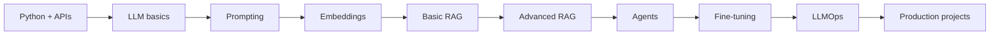

# 01. Roadmap and Learning Path

## Aim

The aim is to become strong enough to build real Generative AI systems, not just call an API. A complete AI engineer should understand:

- AI history and core vocabulary.
- Language models and Transformer intuition.
- Prompting and API usage.
- Embeddings and vector databases.
- RAG and advanced RAG.
- Agents, tools, memory, and multi-agent workflows.
- Fine-tuning and alignment.
- LLMOps: testing, monitoring, deployment, cost, latency, and safety.

## Beginner to Advanced Path

### Stage 1: Foundations

Learn what AI, ML, DL, NLP, and GenAI mean.

Simple explanation:

- AI means making machines behave intelligently.
- ML means machines learn patterns from data.
- DL means ML using neural networks with many layers.
- NLP means working with human language.
- Generative AI means creating new text, image, audio, video, or code.

What to practice:

- Python basics.
- REST API basics.
- JSON.
- Git and GitHub.
- Docker basics.
- Cloud basics.

### Stage 2: Language Models

Study:

- N-gram language models.
- RNN.
- LSTM.
- GRU.
- Encoder-decoder sequence-to-sequence models.
- Attention.
- Transformer.
- Tokenization.
- Pretraining.
- Instruction tuning.
- RLHF or preference optimization.

Core intuition:

A language model predicts useful next tokens. If it has seen enough patterns during training, next-token prediction becomes reasoning-like behavior, summarization, coding, translation, planning, and question answering.

### Stage 3: Prompting and APIs

Study:

- System/developer instructions.
- User prompts.
- Few-shot examples.
- Chain-of-thought style reasoning control.
- Structured output.
- Function calling and tools.
- Safety instructions.
- Model selection.
- Cost and latency.

### Stage 4: Embeddings and RAG

Study:

- Embeddings.
- Similarity search.
- Vector databases.
- Chunking.
- Metadata.
- Retrieval.
- Reranking.
- Prompt assembly.
- Grounded generation.
- Hallucination control.

### Stage 5: Advanced RAG

Study:

- Hybrid search.
- BM25.
- Dense retrieval.
- Reranking.
- Cross encoders.
- Contextual compression.
- Parent document retriever.
- Multi-vector retriever.
- Sentence window retriever.
- HyDE.
- RAG fusion.
- Corrective RAG.
- Self-RAG.
- Agentic RAG.
- Multimodal RAG.
- Graph RAG.

### Stage 6: Frameworks

Study:

- LangChain.
- LCEL.
- LangServe.
- LangSmith.
- LlamaIndex.
- Haystack.
- LangGraph.
- FAISS.
- Chroma.
- Pinecone.
- Weaviate.
- Qdrant.
- Milvus.
- LanceDB.
- MongoDB Atlas Vector Search.
- AstraDB.
- Neo4j knowledge graphs.

### Stage 7: Agents

Study:

- Tool calling.
- ReAct agents.
- Planning agents.
- Router agents.
- Supervisor agents.
- Multi-agent collaboration.
- Human-in-the-loop.
- Checkpoints.
- Breakpoints.
- Memory.
- Agent evaluation.

### Stage 8: Fine-Tuning

Study:

- When to fine-tune.
- When not to fine-tune.
- Dataset preparation.
- Supervised fine-tuning.
- Instruction fine-tuning.
- LoRA.
- QLoRA.
- DPO.
- RLHF.
- RLAIF.
- Distillation.
- Quantization.
- Embedding fine-tuning.
- Multimodal fine-tuning.

### Stage 9: LLMOps and Deployment

Study:

- Modular code.
- Config management.
- Logging.
- FastAPI backend.
- Frontend integration.
- Unit tests.
- Integration tests.
- Evaluation datasets.
- Guardrails.
- Observability.
- Docker.
- CI/CD.
- AWS ECS/Fargate.
- AWS EKS.
- Azure App Service/AKS.
- GCP Cloud Run/Vertex AI.
- Jenkins.
- GitHub Actions.

## Complete Learning Workflow

## Weekly Study Plan

### Month 1: Foundations

- Week 1: Python, Git, VS Code, APIs, JSON.
- Week 2: AI vs ML vs DL vs GenAI.
- Week 3: NLP and language modeling.
- Week 4: Transformer, attention, tokenization.

### Month 2: Application Building

- Week 5: Prompting and API usage.
- Week 6: Embeddings and vector search.
- Week 7: Basic RAG.
- Week 8: LangChain and LlamaIndex projects.

### Month 3: Advanced Systems

- Week 9: Advanced RAG.
- Week 10: Agents and LangGraph.
- Week 11: Fine-tuning.
- Week 12: Deployment and LLMOps.

### Month 4 and Beyond

- Build production-grade projects.
- Learn cloud deployment.
- Learn monitoring and evaluation.
- Read papers and implement ideas.
- Prepare interview answers from real projects.

## What "Advanced" Really Means

Advanced does not mean using the biggest model. Advanced means:

- You know where the model fails.
- You can measure quality.
- You can reduce hallucination.
- You can debug retrieval.
- You can deploy safely.
- You can control cost.
- You can explain tradeoffs.
- You can choose between RAG, fine-tuning, and agents.

