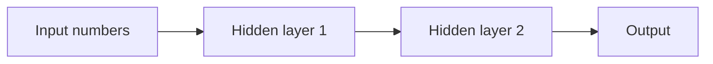
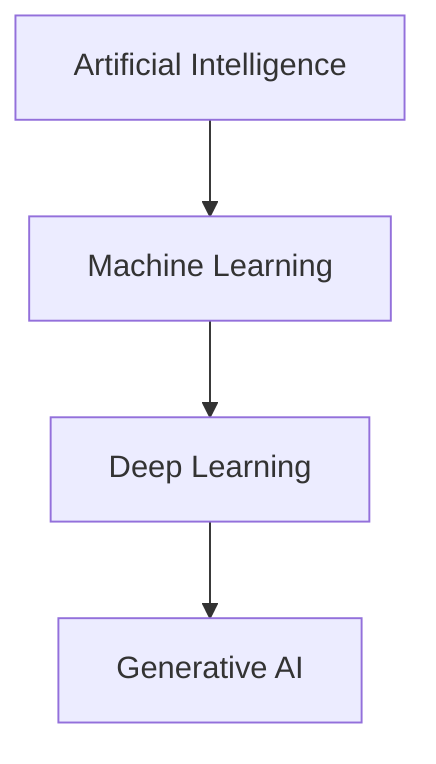
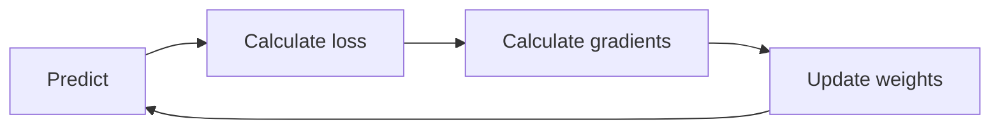

# 02. AI, ML, DL, and Generative AI Foundations

## AI

Artificial Intelligence is the broad field of building machines that can perform tasks that normally need human intelligence.

Examples:

- Answering questions.
- Planning a route.
- Recognizing faces.
- Translating language.
- Writing code.
- Summarizing documents.

AI can be rule-based or learning-based.

Rule-based AI:

```python
def loan_decision(income, credit_score):
    if income > 50000 and credit_score > 700:
        return "approve"
    return "reject"
```

Line-by-line:

- `def loan_decision(...)` creates a function.
- `income` and `credit_score` are inputs.
- The `if` statement checks a fixed rule.
- If the rule is true, the function approves.
- Otherwise, it rejects.

Problem with pure rule-based AI: real life has too many exceptions. Machine learning solves this by learning rules from data.

## Machine Learning

Machine Learning is a way to teach computers from examples instead of manually writing every rule.

Example:

Input data:

| Email Text | Label |
| --- | --- |
| "Win money now" | spam |
| "Meeting at 5 PM" | not spam |

The ML model learns patterns:

- Words like "win", "money", "free" may indicate spam.
- Calendar-like language may indicate normal email.

## Deep Learning

Deep Learning uses neural networks with many layers.

Simple neural network:



Each layer transforms data. Early layers learn simple patterns; later layers learn complex patterns.

## NLP

Natural Language Processing is AI for language.

Main tasks:

- Text classification.
- Sentiment analysis.
- Named entity recognition.
- Question answering.
- Translation.
- Summarization.
- Text generation.

## Generative AI

Generative AI creates new content.

Types:

- Text generation: chatbots, summaries, code.
- Image generation: text-to-image.
- Audio generation: speech and music.
- Video generation: text-to-video.
- Multimodal generation: text plus image plus audio.

## Classical AI vs Modern AI

Classical AI:

- Uses rules, search, logic, expert systems.
- Strong when rules are clear.
- Weak when data is messy.

Modern AI:

- Learns from data.
- Uses neural networks.
- Handles language, images, speech, and code.
- Needs data, compute, evaluation, and monitoring.

## AI vs ML vs DL vs GenAI



Not all AI is ML. Not all ML is DL. Not all DL is GenAI.

## Training vs Inference

Training:

- The model learns from data.
- Expensive.
- Needs GPUs.
- Changes model weights.

Inference:

- The trained model answers a new input.
- Cheaper than training.
- Used in applications.
- Does not usually change weights.

## Model Weights

Weights are numbers inside the model. They store learned patterns.

Simple intuition:

If a model often sees:

```text
The capital of France is Paris.
```

Then its weights change so that when asked about France's capital, "Paris" becomes likely.

## Loss Function

The loss function measures how wrong the model is.

Example:

- Correct answer: `Paris`
- Model answer: `London`
- Loss: high

Training tries to reduce loss.

## Gradient Descent

Gradient descent is the process of slowly adjusting weights to reduce loss.



## Overfitting

Overfitting means the model memorizes training data but performs badly on new data.

Example:

A student memorizes practice questions but fails when the wording changes.

Solutions:

- More data.
- Regularization.
- Dropout.
- Validation set.
- Early stopping.
- Simpler model.

## Underfitting

Underfitting means the model is too simple to learn the pattern.

Example:

Using a straight line to model a complex curve.

Solutions:

- Better features.
- Bigger model.
- More training.
- Better architecture.

## Data Splits

Use:

- Training set: teaches the model.
- Validation set: tunes decisions.
- Test set: final unbiased check.

Never tune on the test set. If you do, the test is no longer honest.

## Evaluation Metrics

Classification:

- Accuracy.
- Precision.
- Recall.
- F1 score.

Generation:

- Human evaluation.
- LLM-as-judge.
- Exact match.
- BLEU/ROUGE for some NLP tasks.
- Faithfulness.
- Groundedness.
- Answer relevance.

RAG:

- Retrieval precision.
- Retrieval recall.
- Context relevance.
- Answer correctness.
- Citation accuracy.
- Latency.
- Cost.

## The Most Important Production Mindset

A demo asks: "Can it work once?"

A production system asks:

- Does it work reliably?
- Does it fail safely?
- Can we measure quality?
- Can we debug bad answers?
- Can we control cost?
- Can users trust it?

