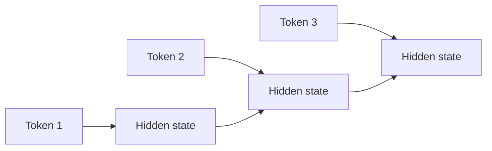
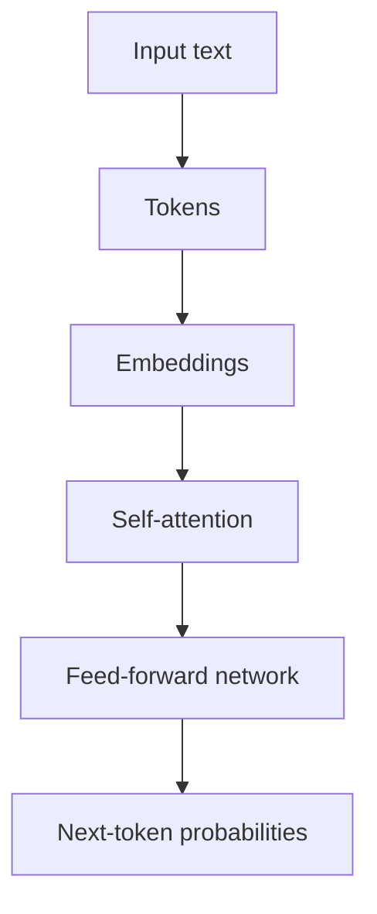
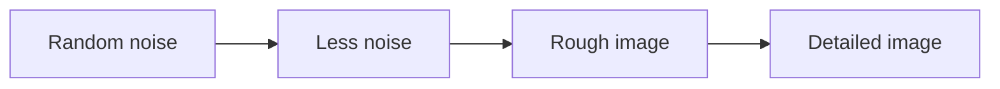
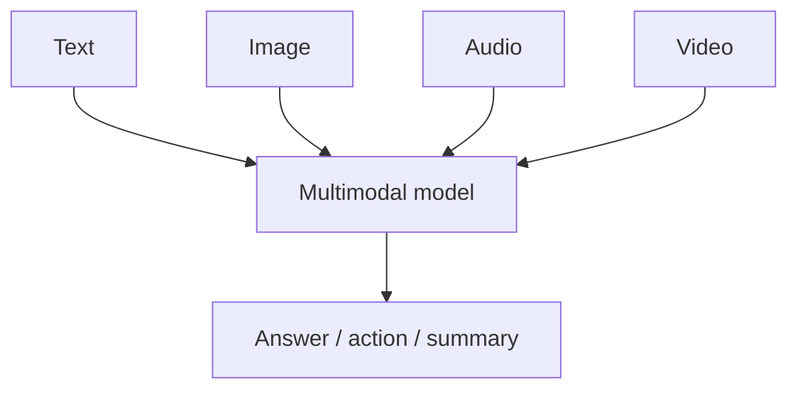

# 03. Language Models, Transformers, Diffusion, and Multimodal AI

## Language Modeling

A language model predicts text.

Basic task:

```text
Input: The sky is
Expected next token: blue
```

The model does not store a simple dictionary of answers. It learns statistical patterns from massive data.

## Tokens

Models do not directly read words. They read tokens.

Example:

```text
"unbelievable" -> ["un", "believ", "able"]
```

Why tokenization matters:

- Cost is based on tokens.
- Context length is measured in tokens.
- Some languages use more tokens than others.
- Bad chunking can split meaning across tokens.

## N-Gram Models

An n-gram model predicts the next word using the previous `n - 1` words.

Example:

```text
Previous words: "I love"
Likely next words: "you", "pizza", "coding"
```

Limitation: n-gram models cannot understand long context well.

## RNN

Recurrent Neural Networks process sequences one step at a time.



Problem: RNNs struggle with long-term dependencies.

Example:

```text
The book that I borrowed from the library last week was very interesting.
```

The model must connect "book" with "was" across many words.

## LSTM

LSTM means Long Short-Term Memory. It improves RNNs using gates.

Gates:

- Forget gate: what to remove.
- Input gate: what to add.
- Output gate: what to expose.

Intuition:

LSTM is like a notebook. It decides what old information to erase, what new information to write, and what information to show.

## GRU

GRU means Gated Recurrent Unit. It is simpler than LSTM.

It has fewer gates and can train faster, but Transformers later became dominant for large language modeling.

## Sequence-to-Sequence Models

Seq2Seq models map one sequence to another.

Example:

```text
Input:  "I am happy"
Output: "Je suis heureux"
```

Useful for:

- Translation.
- Summarization.
- Question answering.

## Attention

Attention lets the model focus on important parts of the input.

Example:

```text
The animal did not cross the street because it was tired.
```

The word "it" likely refers to "animal". Attention helps connect them.

## Transformer

The Transformer is the core architecture behind modern LLMs.

Main parts:

- Token embeddings.
- Positional encoding.
- Self-attention.
- Feed-forward layers.
- Layer normalization.
- Residual connections.



## Self-Attention Step-by-Step

Every token creates three vectors:

- Query: what am I looking for?
- Key: what information do I contain?
- Value: what information should I pass forward?

Simple intuition:

When reading a sentence, each word asks, "Which other words matter to understand me?"

## Multi-Head Attention

One attention head may focus on grammar. Another may focus on topic. Another may focus on entities.

Multiple heads allow the model to learn different relationships at the same time.

## Positional Encoding

Transformers process tokens in parallel, so they need a way to know order.

Without position:

```text
dog bites man
man bites dog
```

The same words have different meaning. Positional information solves this.

## Pretraining

Pretraining teaches general language patterns.

The model learns from large text corpora by predicting missing or next tokens.

## Instruction Tuning

Instruction tuning teaches the model to follow instructions.

Example training pair:

```text
Instruction: Summarize this paragraph.
Answer: ...
```

This turns a raw language model into a useful assistant.

## Alignment

Alignment makes model behavior closer to human preferences.

Methods:

- RLHF.
- RLAIF.
- DPO.
- Safety fine-tuning.
- Policy rules.

## Hallucination

Hallucination means the model generates false or unsupported information.

Causes:

- Missing knowledge.
- Ambiguous prompt.
- Bad retrieval.
- Overconfident generation.
- No grounding requirement.

Solutions:

- RAG.
- Ask for citations.
- Use structured output.
- Add refusal rules.
- Evaluate against trusted data.

## Diffusion Models

Diffusion models are common for image generation.

Idea:

1. Add noise to images during training.
2. Train a model to remove noise.
3. At generation time, start with noise and gradually denoise into an image.



## Text-to-Image

The text prompt guides the image generation model.

Example prompt:

```text
A clean product photo of a red running shoe on a white background, soft studio lighting.
```

Important controls:

- Prompt specificity.
- Negative prompt.
- Style.
- Aspect ratio.
- Seed.
- Guidance scale.

## Text-to-Video

Text-to-video extends generation across time.

Hard problems:

- Motion consistency.
- Character consistency.
- Physics.
- Camera movement.
- Long temporal coherence.

## Multimodal AI

Multimodal AI handles more than one type of data.

Examples:

- Image plus question.
- PDF with text, tables, and charts.
- Video plus transcript.
- Voice assistant with speech input and text output.



## Why Multimodal RAG Matters

Many business documents are not plain text.

They contain:

- Tables.
- Images.
- Screenshots.
- Charts.
- Scanned pages.
- Slide decks.
- Videos.

A strong system extracts, indexes, and retrieves across all of these.

