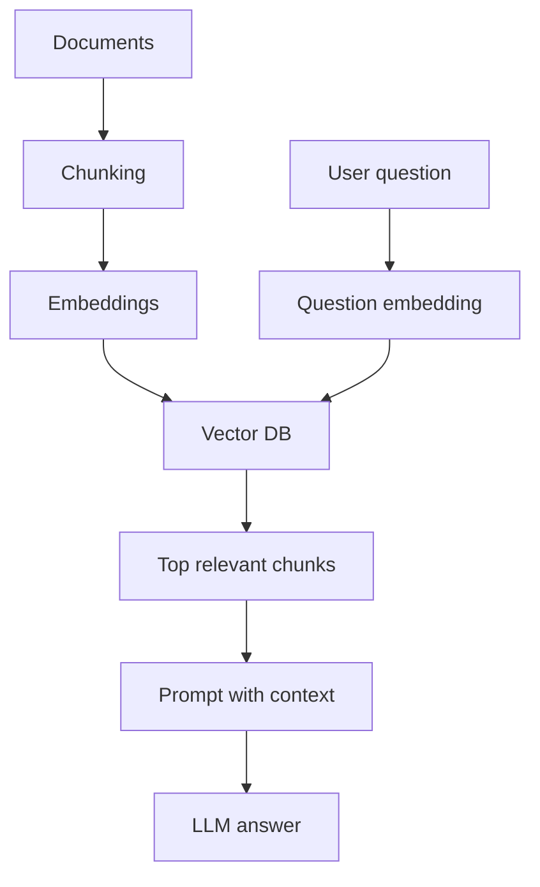

# 05. RAG From Zero to Production

## What is RAG?

RAG means Retrieval-Augmented Generation.

It combines:

- Retrieval: find relevant information.
- Augmented: add that information to the prompt.
- Generation: ask the LLM to answer using the retrieved context.

## Why RAG Exists

LLMs have limits:

- They may not know private company data.
- They may be outdated.
- They can hallucinate.
- They cannot fit every document into the prompt.

RAG solves this by giving the model relevant external knowledge at answer time.

## Basic RAG Diagram



## RAG Pipeline Steps

### Step 1: Load Documents

Documents can be:

- PDF.
- DOCX.
- PPTX.
- TXT.
- HTML.
- CSV.
- Database rows.
- Web pages.
- Images after OCR.
- Video transcripts.

### Step 2: Clean Text

Clean:

- Extra spaces.
- Headers and footers.
- Broken lines.
- Duplicate pages.
- Navigation text.
- Ads.

Bad text creates bad retrieval.

### Step 3: Chunk Documents

Chunking means splitting documents into smaller pieces.

Common strategy:

- 300 to 1000 tokens per chunk.
- 50 to 150 token overlap.
- Keep headings and metadata.

Bad chunking example:

```text
Chunk 1: Refund policy says customers can request...
Chunk 2: ...within 30 days of purchase.
```

The answer is split across chunks.

Better:

```text
Refund policy: customers can request a refund within 30 days of purchase.
```

### Step 4: Create Embeddings

Each chunk becomes a vector.

### Step 5: Store in Vector DB

Store:

- Chunk text.
- Embedding vector.
- Metadata.
- Source file.
- Page number.
- Section title.
- Timestamp.

### Step 6: Retrieve

When a user asks a question:

1. Embed the question.
2. Search for similar chunks.
3. Return top `k` chunks.

### Step 7: Build Prompt

Prompt:

```text
Answer using only the context below.
If the context is insufficient, say you do not know.

Context:
{retrieved_chunks}

Question:
{user_question}
```

### Step 8: Generate Answer

The LLM uses retrieved context to answer.

### Step 9: Cite Sources

Good RAG systems show sources:

```text
Answer: The refund window is 30 days.
Source: policy.pdf, page 4
```

## Minimal RAG Code

See `code/rag_minimal.py` for a runnable starter. The same logic is summarized here:

```python
from sklearn.feature_extraction.text import TfidfVectorizer
from sklearn.metrics.pairwise import cosine_similarity

docs = [
    "Refunds are allowed within 30 days of purchase.",
    "Shipping usually takes 3 to 5 business days.",
    "Premium support is available for enterprise customers."
]

question = "How long do I have to ask for a refund?"

vectorizer = TfidfVectorizer()
doc_vectors = vectorizer.fit_transform(docs)
question_vector = vectorizer.transform([question])

scores = cosine_similarity(question_vector, doc_vectors)[0]
best_index = scores.argmax()

print(docs[best_index])
```

Line-by-line:

- `TfidfVectorizer` converts text into numeric vectors.
- `docs` stores knowledge.
- `question` is the user query.
- `fit_transform(docs)` learns vocabulary and creates document vectors.
- `transform([question])` converts the question into the same vector space.
- `cosine_similarity(...)` compares question with each document.
- `argmax()` finds the best matching document.
- `print(...)` returns the retrieved context.

This is not modern embedding RAG, but it teaches retrieval intuition clearly.

## RAG Failure Modes

| Problem | Cause | Fix |
| --- | --- | --- |
| Wrong answer | Bad retrieval | Improve chunking, hybrid search, reranking |
| No answer | Chunk too small or metadata missing | Better parsing and chunk overlap |
| Hallucination | Prompt allows guessing | Add grounding instruction |
| Slow response | Too many chunks or slow DB | Cache, rerank fewer docs, optimize index |
| Expensive response | Too much context | Compression, smaller models, better retrieval |
| Security leak | Bad permissions | Filter by user access before retrieval |

## Production Checklist

- Ingestion is repeatable.
- Documents have IDs and versions.
- Index updates are logged.
- Retrieval is evaluated.
- User access control is enforced.
- Answers cite sources.
- Bad answers are captured.
- Prompts are versioned.
- Cost and latency are monitored.
- There is a fallback when retrieval fails.

