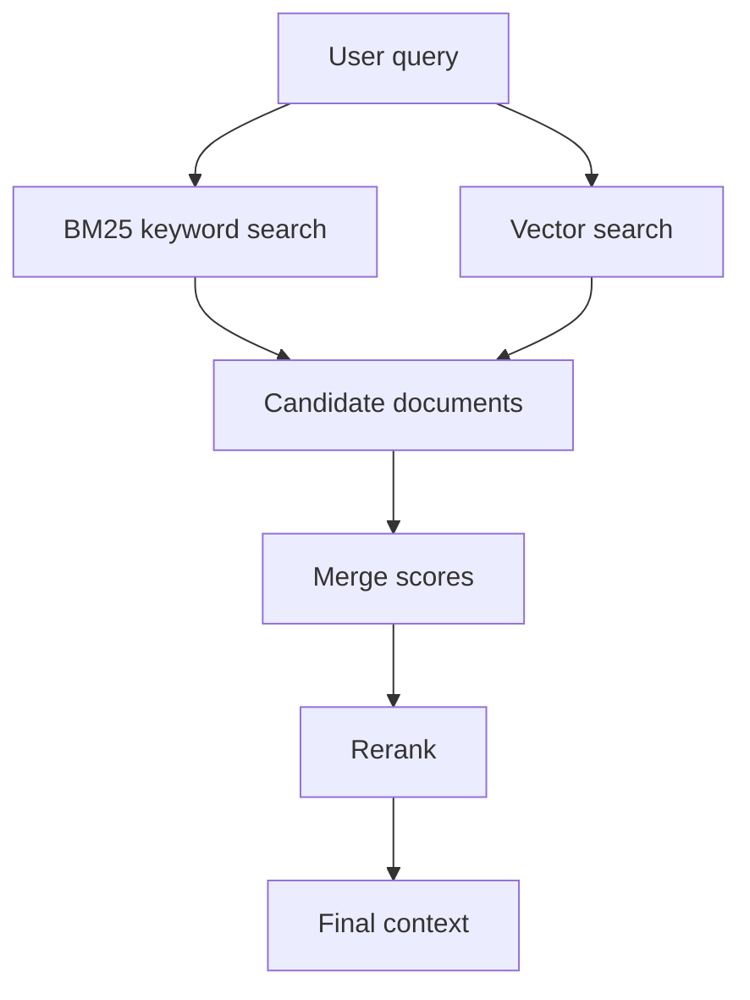
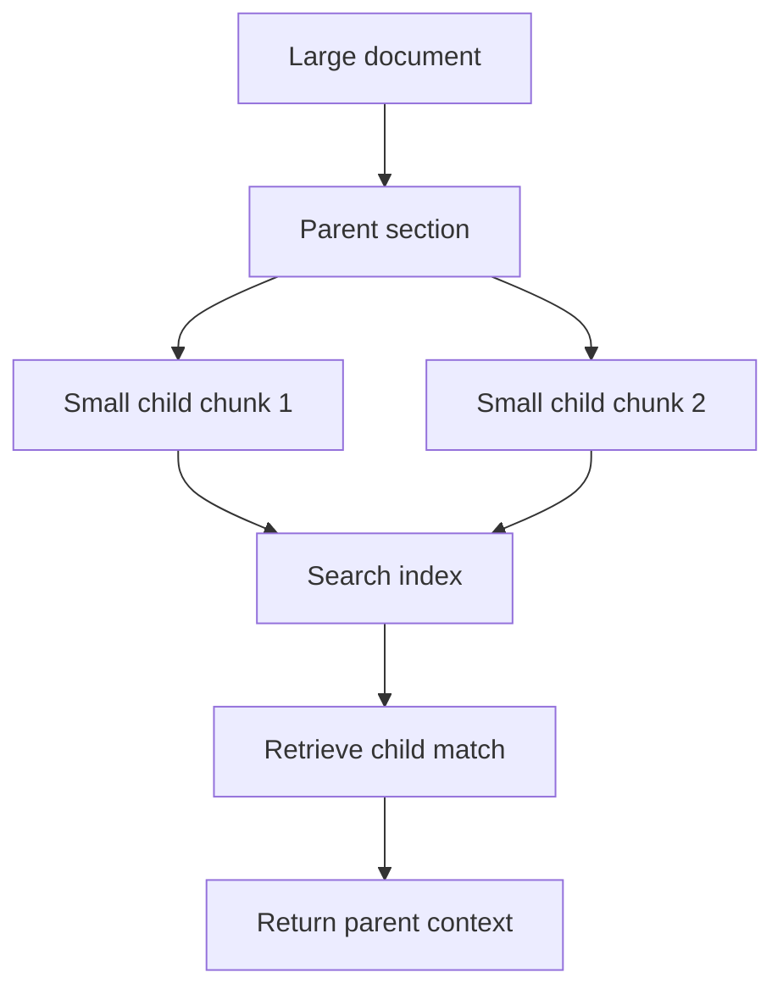
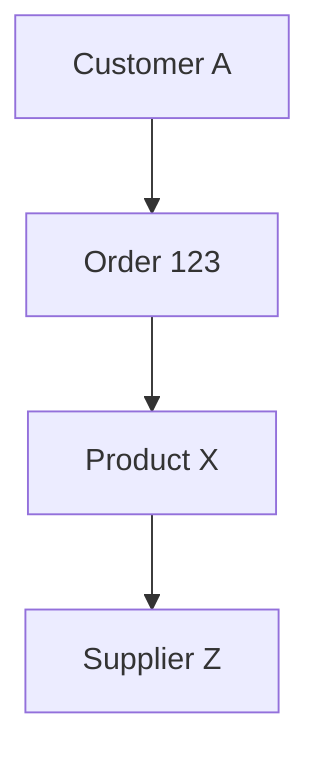

# 06. Advanced RAG, Retrieval, and Reranking

## Why Basic RAG Is Not Enough

Basic vector search works well for simple semantic questions. It fails when:

- The query needs exact keywords.
- The answer is in a table.
- The wording is very different.
- The document has many similar chunks.
- The useful context appears in the middle of a long retrieved passage.
- The user asks a multi-hop question.

Advanced RAG improves retrieval quality before generation.

## Dense Retrieval

Dense retrieval uses embeddings.

Strength:

- Finds meaning even when words differ.

Weakness:

- Can miss exact terms like product codes, IDs, names, numbers.

## Sparse Retrieval / BM25

BM25 is keyword-based search.

Strength:

- Good for exact matches.
- Good for names, codes, rare words.

Weakness:

- Does not understand meaning as deeply as embeddings.

## Hybrid Search

Hybrid search combines dense and sparse retrieval.



Example:

Question:

```text
What is the warranty for XZ-900 router?
```

BM25 finds `XZ-900` exactly. Vector search finds warranty-related text. Together they work better.

## Ensemble Retrieval

Ensemble retrieval combines multiple retrievers.

Example:

- Retriever 1: BM25.
- Retriever 2: vector search.
- Retriever 3: parent document retriever.

The system merges results with weighted scores.

## Reranking

Retriever gets candidates. Reranker sorts candidates more carefully.

Two-stage process:

1. Fast retrieval gets top 20 or 50 chunks.
2. Reranker selects best 3 to 8 chunks.

Rerankers:

- Cross encoders.
- Cohere rerank API.
- Sentence transformers.
- FlashRank-style rerankers.
- LLM reranking for smaller candidate sets.

## Cross Encoder Intuition

Bi-encoder:

- Embeds query separately.
- Embeds document separately.
- Compares vectors.
- Fast.

Cross encoder:

- Reads query and document together.
- More accurate.
- Slower.

## Reciprocal Rank Fusion

RRF merges rankings from multiple retrievers.

Simple idea:

If a document appears near the top in many retrievers, it should rank high overall.

Pseudo-code:

```python
def rrf_score(rank, k=60):
    return 1 / (k + rank)
```

## RAG Fusion

RAG Fusion expands the query into multiple related queries.

Example:

Original:

```text
How do I reduce RAG hallucination?
```

Generated queries:

- How to improve groundedness in RAG?
- How to make RAG answer only from context?
- RAG hallucination prevention techniques.

Each query retrieves results. Results are fused.

## HyDE

HyDE means Hypothetical Document Embeddings.

Steps:

1. Ask LLM to write a hypothetical answer/document.
2. Embed that hypothetical text.
3. Search using that embedding.

Why it works:

The hypothetical answer may look more like real documents than the original question.

## Parent Document Retriever

Problem:

Small chunks retrieve accurately but may miss full context.

Solution:

- Index small child chunks.
- Return larger parent document sections.



## Sentence Window Retriever

Retrieve the matching sentence plus nearby sentences.

Useful when:

- Answers are sentence-level.
- Adjacent sentences contain necessary explanation.

## Contextual Compression

Contextual compression removes irrelevant text from retrieved chunks before sending to the model.

This reduces:

- Cost.
- Latency.
- Distracting context.

## LongContextReorder and Lost in the Middle

LLMs may pay more attention to the beginning and end of context than the middle.

Lost-in-the-middle means important information in the center may be ignored.

Fixes:

- Put highest relevance chunks first.
- Repeat key facts in a concise context summary.
- Use reorder strategies.
- Use shorter context.

## Self-Query Retriever

A self-query retriever converts natural language into structured filters.

Question:

```text
Show me invoices from 2025 above $10,000 for vendor ABC.
```

Structured filter:

```json
{
  "vendor": "ABC",
  "year": 2025,
  "amount_gt": 10000
}
```

Then retrieval uses both semantic search and metadata filters.

## Corrective RAG

Corrective RAG checks if retrieved documents are good enough.

If retrieval is weak:

- Rewrite query.
- Search web.
- Ask a clarifying question.
- Return "I do not know."

## Self-RAG

Self-RAG makes the model critique its own retrieval and generation.

It may ask:

- Is retrieval necessary?
- Are retrieved docs relevant?
- Is the answer supported?

## Agentic RAG

Agentic RAG lets an agent decide:

- Which retriever to use.
- Whether to search again.
- Whether to query SQL.
- Whether to call an API.
- Whether to ask the user for clarification.

## Graph RAG

Graph RAG uses relationships between entities.

Example:



Useful when answers require relationship traversal, not just similar text.

## Advanced RAG Decision Table

| Need | Best Technique |
| --- | --- |
| Exact names/codes | Hybrid search |
| Too many weak chunks | Reranking |
| Query wording mismatch | HyDE or query expansion |
| Small chunk lacks context | Parent document retriever |
| Sentence-level answer | Sentence window |
| Long irrelevant text | Contextual compression |
| Metadata filters | Self-query retriever |
| Multi-hop relationships | Graph RAG |
| System must decide retrieval path | Agentic RAG |

