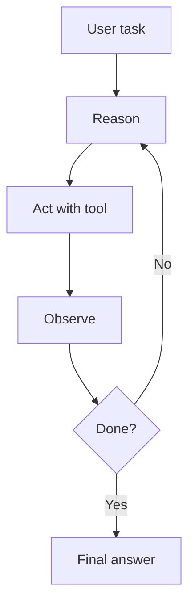
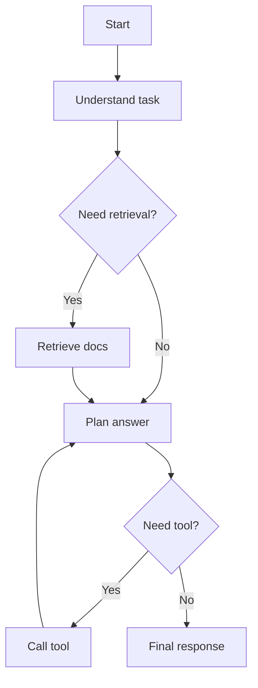
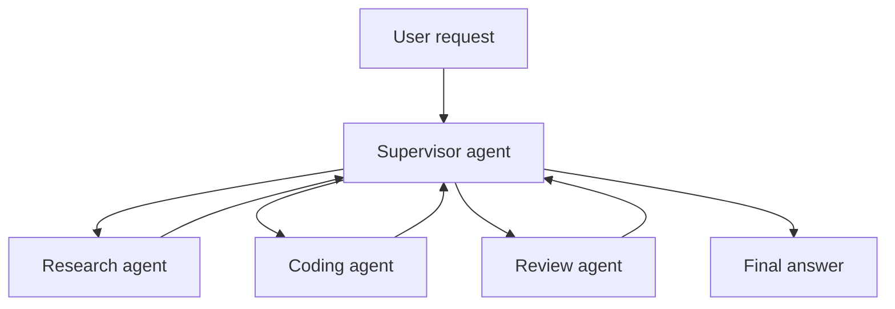
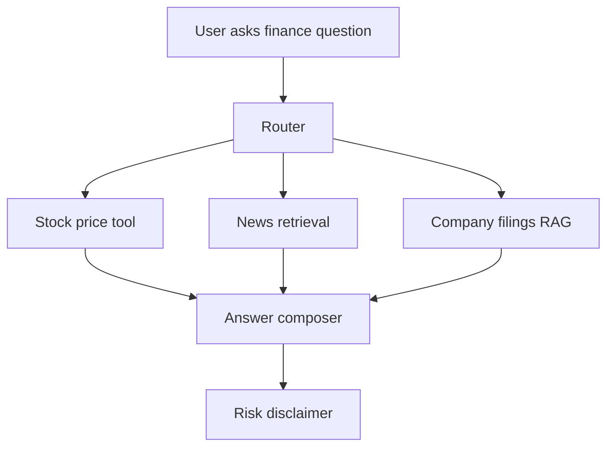
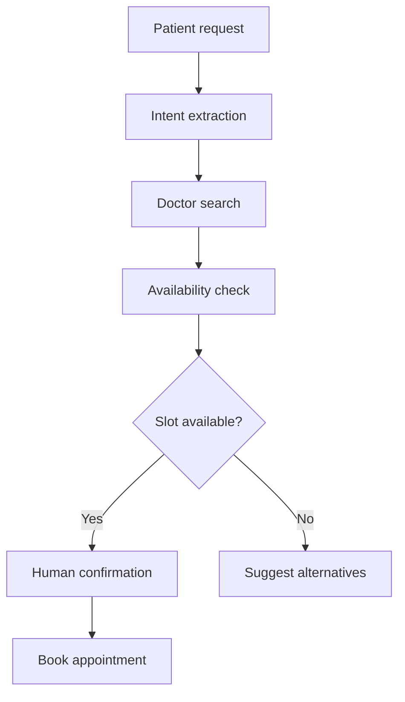

# 08. Agents, LangGraph, Multi-Agent Systems, and Memory

## What Is an Agent?

An agent is an LLM-powered system that can decide steps, use tools, observe results, and continue until it reaches a goal.

Normal chatbot:

```text
User -> LLM -> Answer
```

Agent:

```text
User -> LLM -> Tool -> Observation -> LLM -> Tool -> Final answer
```

## Tool Calling

Tools are functions the model can request.

Examples:

- Search documents.
- Query SQL.
- Send email.
- Create calendar event.
- Call weather API.
- Run calculator.

Tool function example:

```python
def calculate_total(price: float, tax_rate: float) -> float:
    return price + (price * tax_rate)
```

Line-by-line:

- `def` creates a function.
- `price` is the base price.
- `tax_rate` is a decimal like `0.18`.
- The return value is final price plus tax.

## ReAct Agent

ReAct means Reason + Act.

Loop:

1. Think about the task.
2. Choose an action/tool.
3. Observe result.
4. Repeat if needed.
5. Answer.



## Memory

Memory stores useful conversation or user information.

Types:

- Buffer memory: full chat history.
- Window memory: last `k` messages.
- Summary memory: compressed history.
- Entity memory: facts about people, places, objects.
- Vector memory: searchable long-term memory.

## Conversation Buffer Memory

Stores everything.

Problem:

- Grows too large.
- Expensive.
- May include irrelevant details.

## Conversation Buffer Window Memory

Stores only recent turns.

Good when recent context matters most.

## Summary Memory

Summarizes older messages.

Good when conversation is long.

Risk:

- Summary may lose details.

## Entity Memory

Stores facts like:

```json
{
  "user": "Shrinidhi",
  "goal": "learn Generative AI deeply",
  "preferred_style": "simple English with step-by-step notes"
}
```

## LangGraph

LangGraph is useful for stateful agent workflows.

Key ideas:

- Node: one step in workflow.
- Edge: path between steps.
- State: shared data.
- Conditional edge: choose next node based on state.
- Checkpoint: save progress.
- Human-in-the-loop: pause for human approval.

## LangGraph Workflow Diagram



## Corrective RAG Agent

Steps:

1. Retrieve documents.
2. Grade relevance.
3. If weak, rewrite query.
4. Retrieve again.
5. Generate answer.
6. Grade answer support.

## Agentic RAG

Agentic RAG gives the model more control.

It can decide:

- Search vector DB.
- Search keyword index.
- Query SQL.
- Use web search.
- Ask clarification.
- Stop and answer.

## Multi-Agent Systems

Multiple agents work together.

Patterns:

- Network: agents talk freely.
- Supervisor: one manager routes work.
- Hierarchical: manager, sub-managers, workers.
- Debate: agents critique each other.
- Pipeline: each agent handles a fixed stage.

## Supervisor Multi-Agent Diagram



## Human-in-the-Loop

Use human approval when an action is risky:

- Sending money.
- Deleting files.
- Emailing customers.
- Changing production data.
- Deploying code.

## Checkpoints and Breakpoints

Checkpoint:

- Save workflow state.
- Resume later.

Breakpoint:

- Pause before important step.
- Let human inspect or approve.

## Finance Bot Example Architecture



## Doctor Appointment Agent Architecture



## Agent Safety Rules

- Tools must be permissioned.
- Validate all tool arguments.
- Use human approval for irreversible actions.
- Keep audit logs.
- Limit maximum steps.
- Add timeout.
- Detect loops.
- Keep secrets out of prompts.

