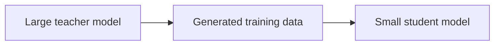

# 09. Fine-Tuning, Alignment, Distillation, and Quantization

## Fine-Tuning Aim

Fine-tuning changes model weights using your data.

Use fine-tuning when you need:

- Specific style.
- Specific output format.
- Domain language.
- Repeated task behavior.
- Smaller model to perform a narrow task.

Do not use fine-tuning just to add factual knowledge. For changing knowledge, RAG is usually better.

## RAG vs Fine-Tuning vs Agents

| Need | Best Choice |
| --- | --- |
| Answer from private documents | RAG |
| Learn style or format | Fine-tuning |
| Use tools and take steps | Agent |
| Keep knowledge fresh | RAG |
| Reduce repeated prompt length | Fine-tuning |
| Complex workflow | Agent or LangGraph |

## Pretraining

Pretraining learns general patterns from huge data.

It is expensive and usually done by model labs, not normal application teams.

## Supervised Fine-Tuning

SFT uses input-output examples.

Example:

```json
{
  "input": "Summarize this support ticket: ...",
  "output": "Customer cannot reset password. Suggested action: send reset link."
}
```

## Instruction Fine-Tuning

Instruction fine-tuning teaches the model to follow task instructions.

Dataset format:

```json
{
  "instruction": "Extract invoice fields.",
  "input": "Invoice text...",
  "output": {
    "invoice_number": "INV-123",
    "amount": 3500
  }
}
```

## Dataset Quality

Fine-tuning quality depends heavily on data quality.

Good dataset:

- Correct.
- Consistent.
- Diverse.
- Clean.
- Representative.
- Has edge cases.

Bad dataset:

- Contradictory.
- Noisy.
- Too small.
- Duplicated.
- Biased.
- Contains private data without permission.

## LoRA

LoRA means Low-Rank Adaptation.

Instead of updating all model weights, LoRA adds small trainable adapter matrices.

Benefits:

- Cheaper.
- Less GPU memory.
- Faster training.
- Easier to store multiple adapters.

## QLoRA

QLoRA combines quantization with LoRA.

Idea:

- Load base model in low precision.
- Train small LoRA adapters.
- Save memory.

Useful for fine-tuning large models on limited GPUs.

## Full Fine-Tuning vs PEFT

Full fine-tuning:

- Updates all weights.
- More expensive.
- More flexible.
- Higher overfitting risk.

PEFT:

- Parameter-efficient fine-tuning.
- Updates small adapters.
- Cheaper.
- Good for most practical tasks.

## Preference Alignment

Preference alignment trains the model to prefer better answers.

Dataset:

```json
{
  "prompt": "Explain RAG simply.",
  "chosen": "RAG retrieves relevant documents and uses them to answer.",
  "rejected": "RAG is a random answer generator."
}
```

## RLHF

RLHF means Reinforcement Learning from Human Feedback.

High-level steps:

1. Generate multiple answers.
2. Humans rank answers.
3. Train a reward model.
4. Optimize model using reinforcement learning.

## DPO

DPO means Direct Preference Optimization.

It trains directly from chosen/rejected pairs without a separate reward model.

Why popular:

- Simpler than RLHF.
- Often stable.
- Works well for preference alignment.

## RLAIF

RLAIF means Reinforcement Learning from AI Feedback.

Instead of humans ranking everything, another AI model provides feedback.

Useful but must be monitored carefully because AI feedback can carry errors.

## Distillation

Knowledge distillation transfers behavior from a large teacher model to a smaller student model.



Use when:

- You need lower latency.
- You need lower cost.
- A smaller model is enough for the task.

## Quantization

Quantization reduces number precision.

Example:

- FP32: high precision, high memory.
- FP16/BF16: common GPU precision.
- INT8: lower memory.
- INT4: much lower memory.

Benefits:

- Lower memory.
- Faster inference.
- Can run on smaller hardware.

Risks:

- Accuracy loss.
- Numerical instability.
- Some tasks degrade more than others.

## PTQ and QAT

PTQ:

- Post-training quantization.
- Quantize after training.
- Easier.

QAT:

- Quantization-aware training.
- Model learns while aware of quantization.
- More work but can preserve quality.

## GPTQ, AWQ, GGUF, llama.cpp

Common open-source inference terms:

- GPTQ: quantization method for transformer weights.
- AWQ: activation-aware weight quantization.
- GGUF: file format used by llama.cpp ecosystem.
- llama.cpp: efficient local inference engine.

## Embedding Fine-Tuning

Fine-tune embeddings when retrieval quality is poor for your domain.

Example:

Generic embedding may not know that:

```text
"SLA breach" and "service level violation"
```

mean similar things in your business.

Training pairs:

- Query.
- Positive document.
- Negative document.

## Multimodal Fine-Tuning

Fine-tuning models that understand image plus text.

Use cases:

- Medical image reports.
- Product defect detection.
- Invoice image extraction.
- Chart understanding.

Extra care:

- Dataset licensing.
- Privacy.
- Evaluation.
- Bias.
- Safety.

