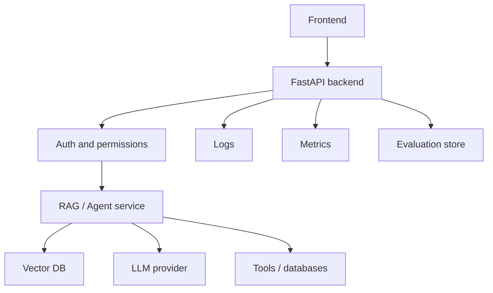

# 10. LLMOps, Testing, Guardrails, and Deployment

## What is LLMOps?

LLMOps is the practice of building, testing, deploying, monitoring, and improving LLM applications.

It extends MLOps because LLM apps have special problems:

- Prompt versions.
- Model versions.
- Retrieval quality.
- Hallucination.
- Tool calls.
- Safety.
- Cost.
- Latency.
- Non-deterministic outputs.

## Production Architecture



## Modular Project Structure

```text
app/
  api/
    routes.py
  core/
    config.py
    logging.py
  rag/
    ingest.py
    retrieve.py
    generate.py
  agents/
    graph.py
  tests/
    test_retrieval.py
    test_api.py
  main.py
Dockerfile
docker-compose.yml
.github/workflows/deploy.yml
```

## Configuration

Use environment variables:

```python
from pydantic import BaseModel
import os


class Settings(BaseModel):
    openai_api_key: str = os.getenv("OPENAI_API_KEY", "")
    model: str = os.getenv("OPENAI_MODEL", "gpt-5.5")
    top_k: int = int(os.getenv("TOP_K", "5"))


settings = Settings()
```

Line-by-line:

- `BaseModel` gives typed configuration.
- `os.getenv` reads environment variables.
- Defaults keep local development simple.
- Production should inject real secrets securely.

## Logging

Log:

- Request ID.
- User ID or tenant ID.
- Model name.
- Prompt version.
- Retrieval IDs.
- Latency.
- Token usage.
- Errors.
- Safety decisions.

Do not log:

- API keys.
- Passwords.
- Sensitive personal data unless explicitly allowed and protected.

## Testing LLM Apps

### Unit Tests

Test deterministic code:

- Chunking.
- Metadata filters.
- Prompt formatting.
- JSON parsing.
- Tool argument validation.

### Integration Tests

Test components together:

- API endpoint calls RAG service.
- Retriever returns relevant chunks.
- Vector DB connection works.
- Tool call result is included in answer.

### Evaluation Tests

Use a dataset:

```json
{
  "question": "What is the refund policy?",
  "expected_facts": ["30 days", "proof of purchase"],
  "source": "policy.pdf"
}
```

Measure:

- Answer correctness.
- Faithfulness.
- Retrieval relevance.
- Source accuracy.
- Latency.
- Cost.

## Guardrails

Guardrails protect the system.

Input guardrails:

- Reject unsupported file types.
- Detect prompt injection.
- Validate user permissions.

Retrieval guardrails:

- Filter documents by user access.
- Never retrieve documents from other tenants.

Output guardrails:

- Check toxic content.
- Check unsupported claims.
- Require citations for factual answers.
- Validate JSON schema.

Tool guardrails:

- Allowlist tools.
- Validate arguments.
- Ask human approval for risky actions.

## FastAPI Deployment Flow

Local run:

```bash
uvicorn app.main:app --reload --port 8000
```

Production run:

```bash
uvicorn app.main:app --host 0.0.0.0 --port 8000
```

## Dockerfile

See `code/Dockerfile`. Standard flow:

```bash
docker build -t genai-rag-api .
docker run -p 8000:8000 --env-file .env genai-rag-api
```

## Docker Compose

Use Docker Compose when you have multiple services:

- API.
- Vector DB.
- Redis.
- Postgres.
- Monitoring.

```bash
docker compose up --build
```

## GitHub Actions CI/CD

Typical pipeline:

1. Checkout code.
2. Install dependencies.
3. Run tests.
4. Build Docker image.
5. Push image to registry.
6. Deploy to cloud.

## AWS ECS/Fargate Deployment Steps

1. Create Docker image.
2. Push to Amazon ECR.
3. Create ECS cluster.
4. Create task definition.
5. Add environment variables and secrets.
6. Create Fargate service.
7. Attach load balancer.
8. Configure health check.
9. Configure autoscaling.
10. Monitor logs in CloudWatch.

## AWS EKS Deployment Steps

1. Build Docker image.
2. Push image to ECR.
3. Create EKS cluster.
4. Create Kubernetes deployment YAML.
5. Create service YAML.
6. Configure ingress.
7. Store secrets in AWS Secrets Manager or Kubernetes secrets.
8. Deploy with `kubectl apply`.
9. Add monitoring.
10. Add CI/CD with GitHub Actions or Jenkins.

## Azure Deployment Steps

Simple App Service:

1. Containerize app.
2. Push image to Azure Container Registry.
3. Create App Service for Containers.
4. Configure environment variables.
5. Enable managed identity if needed.
6. Set health checks.
7. Monitor with Azure Monitor.

AKS:

1. Push image to ACR.
2. Create AKS cluster.
3. Deploy Kubernetes manifests.
4. Configure ingress controller.
5. Use Key Vault for secrets.
6. Monitor with Azure Monitor.

## GCP Deployment Steps

Cloud Run:

1. Build container image.
2. Push to Artifact Registry.
3. Deploy to Cloud Run.
4. Add environment variables.
5. Connect secrets from Secret Manager.
6. Configure minimum/maximum instances.
7. Monitor with Cloud Logging.

Vertex AI:

- Use for model endpoints, tuning, and managed ML workflows.
- Good when your AI stack is already on GCP.

## Jenkins CI/CD

Jenkins pipeline stages:

- Checkout.
- Install.
- Test.
- Build Docker image.
- Push image.
- Deploy.

Use Jenkins when your organization already has Jenkins infrastructure or needs custom enterprise workflows.

## Production Readiness Checklist

- Authentication implemented.
- Authorization enforced before retrieval.
- Secrets stored outside code.
- Prompt injection defenses added.
- Evals run in CI.
- Human approval for risky tools.
- Logs and metrics available.
- Rate limits configured.
- Cost alerts enabled.
- Model fallback strategy defined.
- Rollback process tested.

