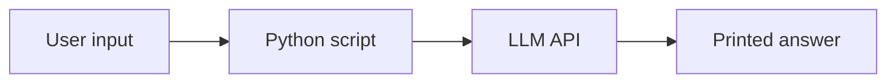
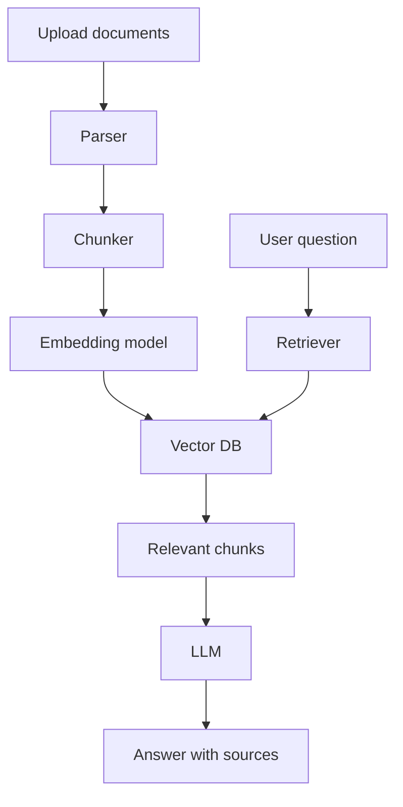
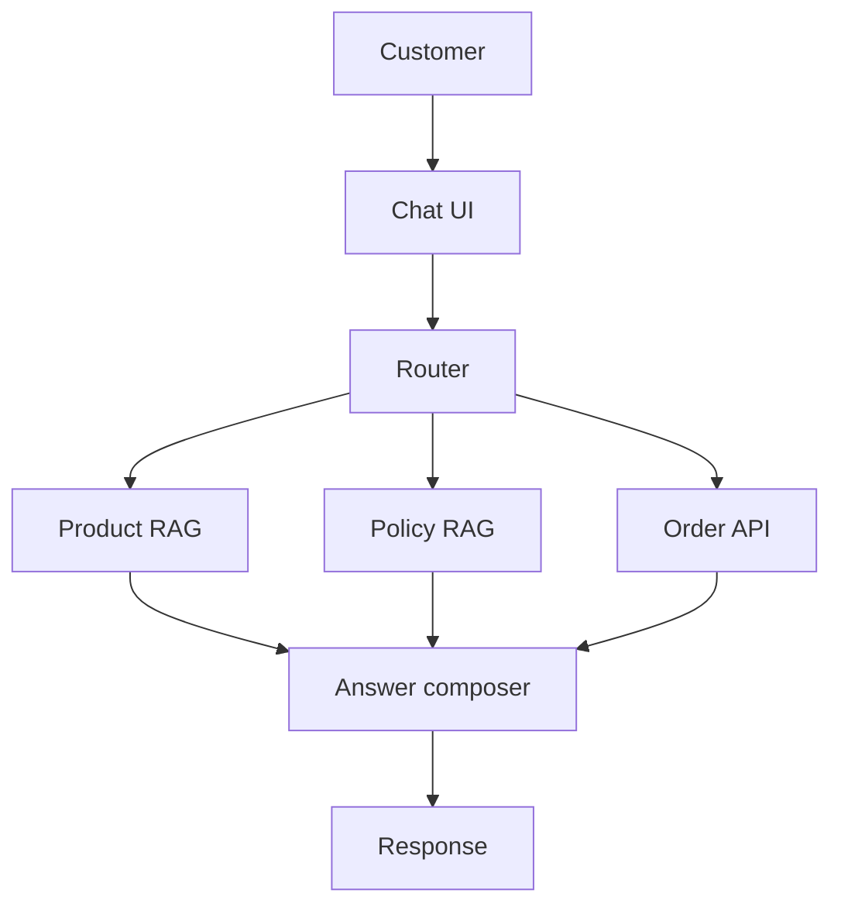
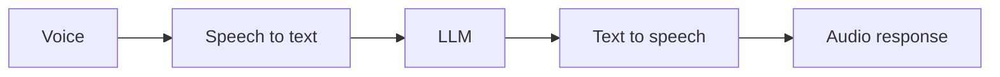
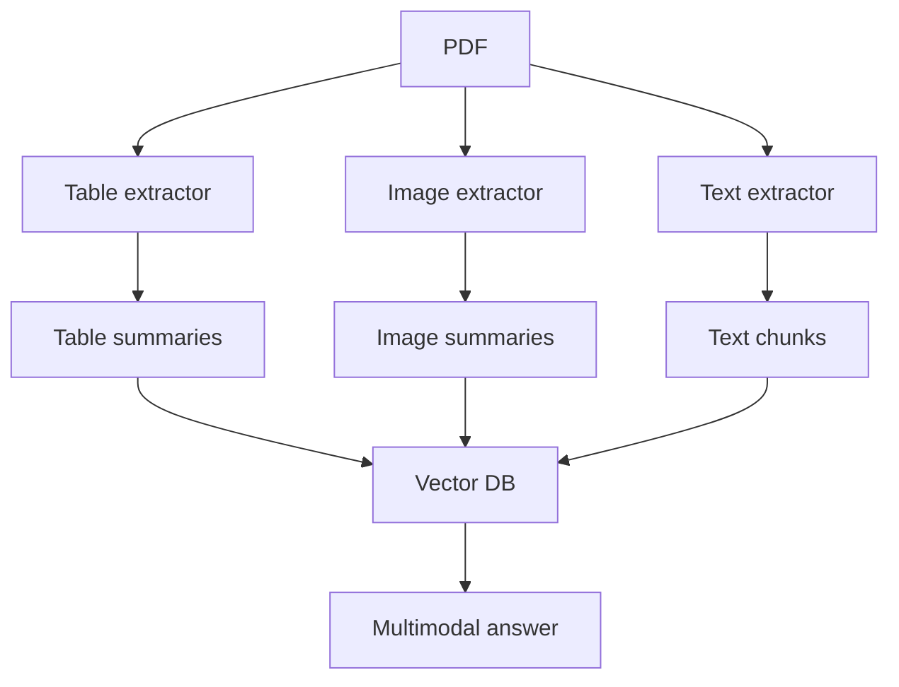

# 11. End-to-End Projects With Deployment Steps

This file gives multiple complete project blueprints. Build them in order.

## Project 1: Simple OpenAI Text Assistant

### Aim

Build a command-line assistant that sends a prompt to an LLM and prints the answer.

### Architecture



### Steps

1. Create virtual environment.
2. Install SDK.
3. Set API key.
4. Send prompt.
5. Print response.

### Code

```python
from openai import OpenAI

client = OpenAI()

question = input("Ask something: ")

response = client.responses.create(
    model="gpt-5.5",
    instructions="Answer in simple English.",
    input=question,
)

print(response.output_text)
```

### Deployment

This is a local script. No cloud deployment needed. For scheduled use, run it from cron, Task Scheduler, or a small API wrapper.

## Project 2: Multi-Document RAG Chatbot

### Aim

Chat with PDF, DOCX, TXT, and PPTX documents.

### Architecture



### Components

- Backend: FastAPI.
- Frontend: Streamlit or React.
- Vector DB: FAISS locally, Pinecone/Qdrant/Weaviate in production.
- LLM: OpenAI, Gemini, Mistral, or local Ollama.
- Storage: S3/Azure Blob/GCS for uploaded files.

### Steps

1. Upload files.
2. Extract text.
3. Split text into chunks.
4. Create embeddings.
5. Store embeddings and metadata.
6. On question, retrieve relevant chunks.
7. Build grounded prompt.
8. Generate answer.
9. Return answer with source names and page numbers.

### Deployment

Local:

```bash
uvicorn app.main:app --reload
```

Docker:

```bash
docker build -t multidoc-rag .
docker run -p 8000:8000 --env-file .env multidoc-rag
```

AWS:

1. Push image to ECR.
2. Deploy to ECS Fargate.
3. Use S3 for document storage.
4. Use Pinecone/Qdrant Cloud or OpenSearch for retrieval.
5. Use CloudWatch logs.

## Project 3: E-Commerce Chatbot

### Aim

Answer product, order, return, and policy questions.

### Data Sources

- Product catalog.
- FAQ.
- Return policy.
- Shipping policy.
- Order database.

### Architecture



### Important Rules

- Public product info can be retrieved freely.
- Order info requires authentication.
- Refund action requires confirmation.
- Never expose another customer's order.

### Deployment

1. Backend on AWS ECS or Azure App Service.
2. Product data in Postgres or MongoDB.
3. Vector search in Pinecone, Qdrant, Weaviate, or MongoDB Atlas.
4. Secrets in cloud secret manager.
5. CI/CD through GitHub Actions or Jenkins.

## Project 4: Multilingual Voice Assistant

### Aim

User speaks in one language, system answers by voice.

### Components

- Speech-to-text.
- LLM.
- Translation if needed.
- Text-to-speech.
- Conversation memory.

### Architecture



### Deployment

- For prototype: Streamlit or Gradio.
- For production: Web app plus backend websocket.
- Use caching for repeated answers.
- Monitor audio latency carefully.

## Project 5: Multimodal RAG for Documents

### Aim

Answer questions from documents containing text, tables, and images.

### Pipeline

1. Parse PDF.
2. Extract text.
3. Extract tables.
4. Extract images.
5. OCR images if needed.
6. Summarize each image/table.
7. Store text chunks and summaries.
8. Retrieve relevant text/table/image summaries.
9. Generate answer with citations.

### Architecture



## Project 6: Real-Time RAG With MongoDB and Pinecone

### Aim

Keep application database and vector index synchronized.

### Steps

1. Store source records in MongoDB.
2. Watch changes.
3. When record changes, create new embedding.
4. Upsert vector into Pinecone.
5. Keep record ID as metadata.
6. On delete, remove vector.

### Key Production Concern

Avoid stale indexes. Every document update should update the vector store.

## Project 7: Knowledge Graph RAG With Neo4j

### Aim

Answer questions requiring relationships.

Example:

```text
Which suppliers are connected to delayed orders for Product X?
```

This may require traversing:

```text
Product -> Order -> Shipment -> Supplier
```

### Deployment

- Neo4j Aura or self-hosted Neo4j.
- Backend FastAPI.
- LLM for query generation and explanation.
- Strict query validation before execution.

## Project 8: LangGraph Doctor Appointment Agent

### Aim

Build an agent that books doctor appointments with human confirmation.

### Nodes

- Understand request.
- Extract symptoms/specialty.
- Search doctors.
- Check slots.
- Ask confirmation.
- Book appointment.
- Send final details.

### Human Approval

Booking should pause before final confirmation.

## Project 9: Fine-Tuned Support Classifier

### Aim

Classify support tickets into categories and priority.

### Dataset

```json
{
  "ticket": "I cannot access my account and password reset is not working.",
  "category": "account_access",
  "priority": "high"
}
```

### Steps

1. Collect labeled tickets.
2. Clean private data.
3. Split train/validation/test.
4. Fine-tune model.
5. Evaluate accuracy and confusion matrix.
6. Deploy behind API.

## Project 10: Advanced RAG With LLMOps

### Aim

Build a production-grade RAG app with modular code, tests, evals, Docker, and CI/CD.

### Modules

- Config.
- Logger.
- Ingestion.
- Retrieval.
- Reranking.
- Generation.
- Evaluation.
- API.
- UI.
- Deployment.

### Deployment Steps

1. Build locally.
2. Add unit tests.
3. Add integration tests.
4. Add eval dataset.
5. Add Dockerfile.
6. Add GitHub Actions.
7. Push image to registry.
8. Deploy to ECS/Fargate or Cloud Run.
9. Add monitoring.
10. Add feedback loop.

