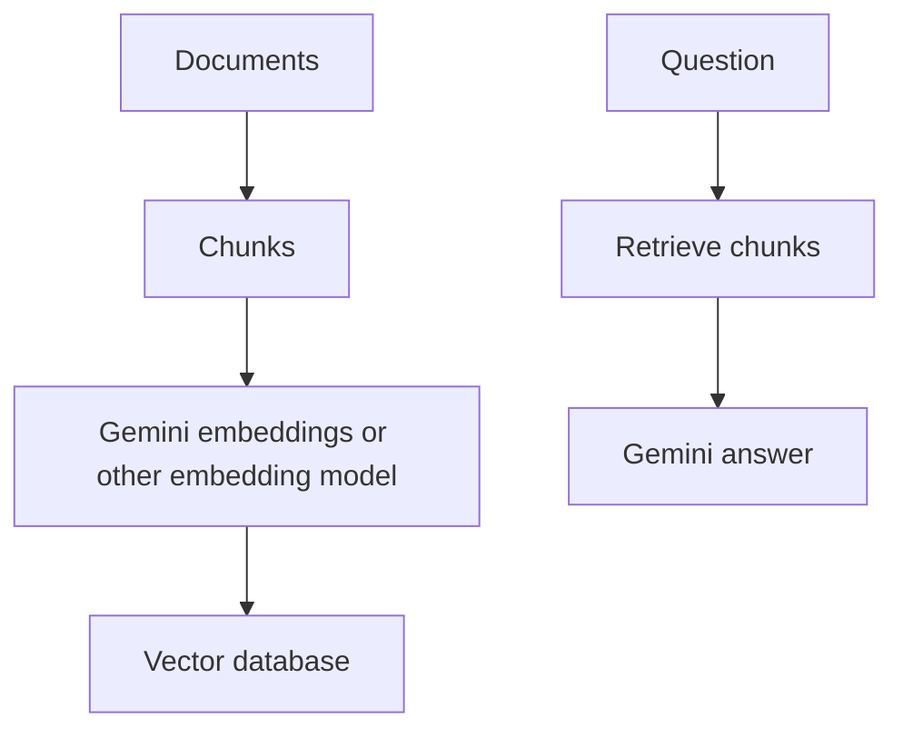
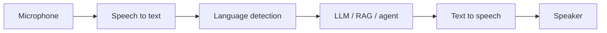
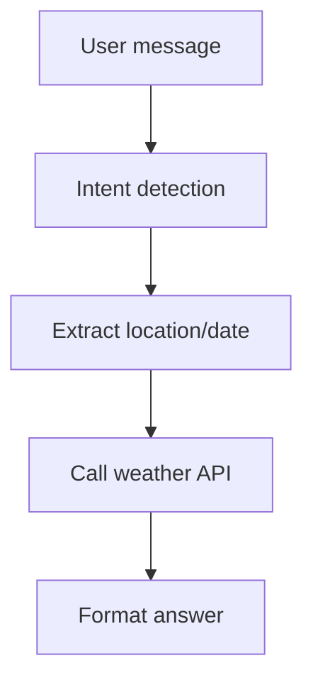
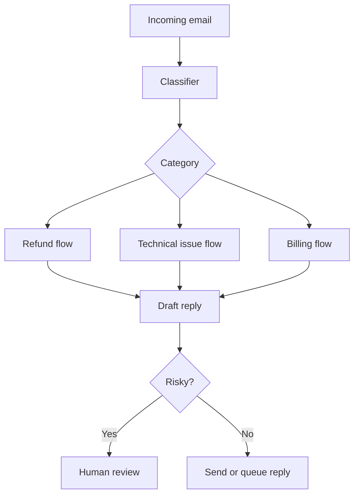

# 13. Setup, Gemini, Video, Voice, Dialogflow, Coding Agents, and Extra Topics

This appendix covers roadmap topics that sit around the main GenAI/RAG/agent path.

## Complete Local Setup for AI Development

### Aim

Create a machine setup where you can build ML, DL, GenAI, RAG, and agent projects without fighting your tools every day.

### Required Tools

- Python 3.11 or 3.12.
- Git.
- VS Code.
- Docker Desktop.
- Conda or venv.
- Node.js for frontend and some AI SDKs.
- Cloud CLI depending on provider: AWS CLI, Azure CLI, or Google Cloud CLI.

### Recommended Folder Structure

```text
genai-workspace/
  datasets/
  notebooks/
  projects/
    rag-chatbot/
    agent-bot/
    finetuning/
  shared/
    prompts/
    evals/
    scripts/
```

### Python Environment

```bash
python -m venv .venv
source .venv/bin/activate
pip install --upgrade pip
```

Windows PowerShell:

```powershell
python -m venv .venv
.\.venv\Scripts\Activate.ps1
python -m pip install --upgrade pip
```

### Conda Environment

```bash
conda create -n genai python=3.12
conda activate genai
```

Use Conda when you need heavier scientific packages, CUDA dependencies, or multiple project environments.

## VS Code Extensions for AI Development

Extension marketplaces change over time, so think in categories.

Useful categories:

- Python language support.
- Jupyter notebooks.
- Docker.
- Git history and GitLens-style tools.
- YAML and TOML support.
- REST client.
- Markdown preview.
- SQL tools.
- Kubernetes tools.
- Cloud provider tools.
- Code formatting.
- Linting.
- Environment variable helpers.
- AI coding assistant, if allowed by your team.

Minimum useful set:

- Python.
- Jupyter.
- Docker.
- GitLens or equivalent.
- YAML.
- Markdown All in One or equivalent.
- REST Client or Thunder Client style extension.

## Google Gemini API

Gemini is Google's multimodal model family. You can use it for text, image understanding, embeddings, tools, and agent-style workflows.

### Current Python Style

The current Google documentation shows the `google-genai` SDK and an Interactions API style.

Install:

```bash
pip install -U google-genai
```

Environment:

```bash
export GEMINI_API_KEY="your_key_here"
```

Python:

```python
from google import genai

client = genai.Client()

interaction = client.interactions.create(
    model="gemini-3.5-flash",
    input="Explain RAG in simple English."
)

print(interaction.output_text)
```

Line-by-line:

- `from google import genai` imports the SDK.
- `genai.Client()` creates the client and reads the API key from the environment.
- `client.interactions.create(...)` sends a model request.
- `model=...` chooses the Gemini model.
- `input=...` is the user request.
- `interaction.output_text` prints the final text.

### Gemini Streaming

```python
from google import genai

client = genai.Client()

stream = client.interactions.create(
    model="gemini-3.5-flash",
    input="Explain transformers step by step.",
    stream=True,
)

for event in stream:
    print(event)
```

Use streaming when:

- The answer is long.
- You want a chat UI to feel responsive.
- You need partial tokens/events.

### Gemini in RAG

Gemini can be used as:

- Generator model.
- Embedding model.
- Vision model for image/table understanding.
- Tool-calling model.

Generic RAG with Gemini:



## Text-to-Video and SORA-Style Systems

Text-to-video models create video from prompts.

Input:

```text
A realistic 8 second video of a robot chef preparing dosa in a bright modern kitchen.
Camera slowly moves from left to right.
```

Important prompt parts:

- Subject.
- Action.
- Scene.
- Camera movement.
- Lighting.
- Duration.
- Style.
- Constraints.

Challenges:

- Consistent characters.
- Accurate physics.
- Smooth motion.
- No flickering.
- Handling text inside video.
- Copyright and likeness safety.

Use cases:

- Product ads.
- Education visuals.
- Storyboarding.
- Game concept videos.
- Training simulations.

Production warning:

Always check license, consent, safety, and brand rules before using generated video commercially.

## Multilingual Voice Assistant

### Aim

Build an assistant that listens, understands, answers, and speaks.

### Pipeline



### Simple Python Pseudocode

```python
def voice_assistant(audio_bytes):
    text = speech_to_text(audio_bytes)
    answer = llm_generate(text)
    output_audio = text_to_speech(answer)
    return output_audio
```

Line-by-line:

- `audio_bytes` is the user's voice recording.
- `speech_to_text` converts audio into text.
- `llm_generate` creates the answer.
- `text_to_speech` converts answer text into spoken audio.
- The function returns playable audio.

## Dialogflow-Style Weather Chatbot

Dialogflow is used for intent-based conversational bots.

Core concepts:

- Intent: what the user wants.
- Entity: important value inside the request.
- Fulfillment: backend function that performs the action.
- Context: conversation state.

Example:

User:

```text
What is the weather in Bengaluru tomorrow?
```

Intent:

```text
get_weather
```

Entities:

```json
{
  "location": "Bengaluru",
  "date": "tomorrow"
}
```

Fulfillment flow:



Dialogflow-style bots are good when the flow is predictable. LLM agents are better when tasks are open-ended.

## Customer Support Email Agent

### Aim

Automatically read customer support emails, classify them, draft replies, and escalate risky cases.

### Architecture



### Guardrails

- Do not send angry or unsafe replies.
- Do not promise refunds unless policy allows it.
- Do not expose internal notes.
- Escalate legal, medical, financial, or abusive messages.
- Keep audit logs.

## AI Coding Agents and Vibe Engineering

AI coding agents help with:

- Project scaffolding.
- Code explanation.
- Refactoring.
- Test writing.
- Bug fixing.
- Documentation.
- Deployment scripts.

Good workflow:

1. Give the goal.
2. Give constraints.
3. Let the agent inspect the codebase.
4. Ask for implementation.
5. Run tests.
6. Review diff.
7. Iterate.

Bad workflow:

- Asking for huge changes without tests.
- Not reviewing generated code.
- Giving secrets in prompts.
- Deploying without verification.

## From Roadmap to Portfolio

Build these portfolio projects:

1. Basic LLM API assistant.
2. PDF RAG chatbot.
3. Advanced RAG with hybrid search and reranking.
4. Multimodal document RAG.
5. LangGraph agent with tools and memory.
6. Multi-agent research assistant.
7. Fine-tuned classifier or instruction model.
8. Production LLMOps app with Docker, CI/CD, evals, and guardrails.

## Final Master Checklist

- Local environment works.
- You can call OpenAI or Gemini APIs.
- You understand embeddings.
- You built basic RAG.
- You improved RAG with reranking.
- You built a LangGraph workflow.
- You understand when fine-tuning is useful.
- You can containerize with Docker.
- You can deploy to at least one cloud.
- You can explain safety, evaluation, and monitoring.

