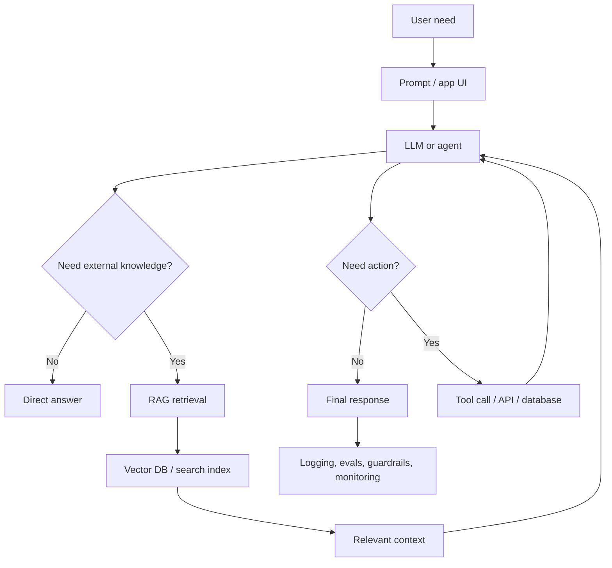

# Generative AI Complete Course Notes

This folder is a beginner-to-advanced documentation pack built from the supplied roadmap and expanded beyond it. It is written in simple English, with intuition, procedures, diagrams, examples, code, deployment notes, and project ideas.

## How to Study This

1. Read `01_roadmap_and_learning_path.md` first.
2. Study foundations before frameworks. Frameworks become easy when AI, embeddings, retrieval, and agents are clear.
3. Run the small code examples before jumping into full projects.
4. For every topic, ask four questions:
   - What problem does it solve?
   - What input does it take?
   - What output does it produce?
   - What can go wrong in production?

## File Map

| File | Purpose |
| --- | --- |
| `01_roadmap_and_learning_path.md` | Full study path from beginner to advanced |
| `02_ai_ml_dl_genai_foundations.md` | AI, ML, DL, GenAI, history, intuition |
| `03_language_models_transformers_diffusion_multimodal.md` | RNN, LSTM, GRU, Transformers, LLMs, diffusion, multimodal |
| `04_prompting_apis_embeddings_safety.md` | Prompting, OpenAI/Gemini style APIs, embeddings, safety settings |
| `05_rag_from_zero_to_production.md` | RAG architecture, ingestion, chunking, retrieval, generation |
| `06_advanced_rag_retrieval_reranking.md` | Hybrid search, reranking, RAG fusion, HyDE, parent doc, sentence window |
| `07_frameworks_langchain_llamaindex_haystack.md` | LangChain, LlamaIndex, Haystack, FAISS, Pinecone, Weaviate, Qdrant, LanceDB |
| `08_agents_langgraph_multi_agent_memory.md` | Tools, agents, ReAct, LangGraph, memory, human-in-loop, multi-agent systems |
| `09_finetuning_alignment_quantization.md` | Fine-tuning, LoRA, QLoRA, DPO, RLHF, distillation, quantization |
| `10_llmops_testing_guardrails_deployment.md` | FastAPI, tests, evals, guardrails, Docker, AWS/Azure/GCP deployment, CI/CD |
| `11_end_to_end_projects.md` | Multiple complete project blueprints with deployment steps |
| `12_interview_questions_glossary.md` | Interview questions, revision checklist, glossary |
| `13_setup_gemini_video_voice_dialogflow_extra_topics.md` | Setup, Gemini, text-to-video, voice, Dialogflow, coding agents, VS Code tooling |
| `code/` | Starter code templates |

## Big Picture Diagram



## Minimum Setup

Install Python and create a virtual environment:

```bash
python -m venv .venv
source .venv/bin/activate
pip install openai fastapi uvicorn pydantic numpy scikit-learn python-dotenv
```

On Windows PowerShell:

```powershell
python -m venv .venv
.\.venv\Scripts\Activate.ps1
pip install openai fastapi uvicorn pydantic numpy scikit-learn python-dotenv
```

Create `.env`:

```bash
OPENAI_API_KEY=your_key_here
OPENAI_MODEL=gpt-5.5
```

You can replace OpenAI with Gemini, Mistral, Anthropic, Ollama, or a self-hosted model. The ideas stay the same: prompt, retrieve, reason, generate, evaluate, deploy.
