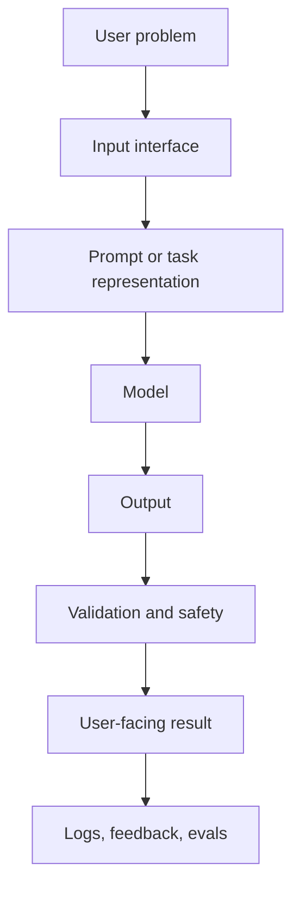
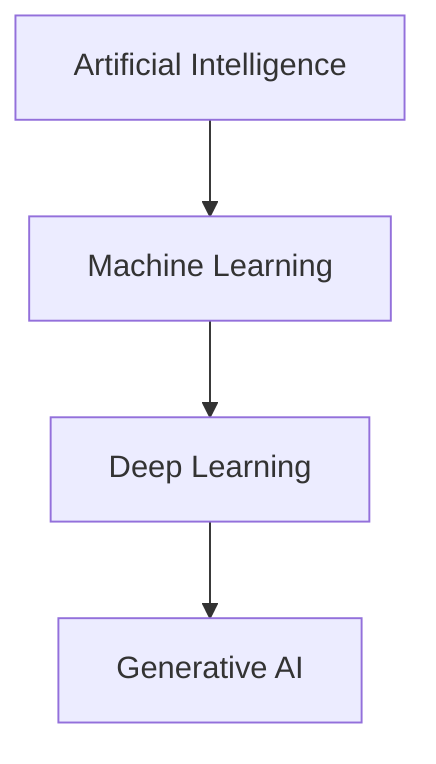
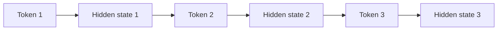
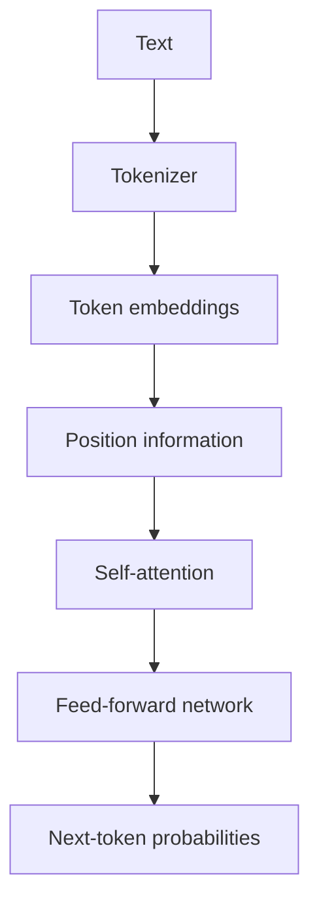

# 01. Beginner to Advanced GenAI Deep Notes

## The Real Aim

The real aim is not to memorize model names. The aim is to understand how intelligent software is built from data, algorithms, models, retrieval, tools, evaluation, and deployment.

Every GenAI application has the same big structure:



If the model needs private knowledge, add retrieval. If it needs action, add tools. If it needs stable behavior, add testing. If it must run for real users, add LLMOps.

## AI vs ML vs DL vs GenAI

AI is the largest circle. It means machines performing tasks that seem intelligent.

ML is a subset of AI where the machine learns from data.

DL is a subset of ML where the model is a neural network with many layers.

GenAI is a subset of modern deep learning where the model creates new content.



### Example

Rule-based AI:

```python
def is_spam(email_text):
    if "free money" in email_text.lower():
        return True
    return False
```

This is AI because it behaves like a simple decision system. It is not ML because it does not learn.

Machine learning version:

1. Collect many emails.
2. Label them spam or not spam.
3. Train a model.
4. Use the model on future emails.

Deep learning version:

Use a neural network that learns more complex patterns.

Generative AI version:

Ask a language model to write a reply, summarize the email, or explain why it may be spam.

## Classical AI vs Modern AI

Classical AI uses rules, logic, planning, search, and expert systems.

Modern AI uses data-driven learning. It learns patterns instead of requiring humans to write every rule.

Classical AI is good when:

- The rules are clear.
- The environment is small.
- Every condition is known.

Modern AI is good when:

- Data is messy.
- Language is ambiguous.
- Images/audio/video are involved.
- The rules are too hard to write manually.

## Language Modeling

A language model predicts text. The basic training task is:

```text
Given previous tokens, predict the next token.
```

Example:

```text
Input: The capital of India is
Likely next token: Delhi
```

This simple training task becomes powerful because language contains facts, reasoning patterns, code patterns, dialogue patterns, and writing patterns.

## Tokens

A token is a unit of text. It can be a word, part of a word, punctuation, or symbol.

Why tokens matter:

- Context windows are counted in tokens.
- Pricing is usually token-based.
- Long documents must be chunked by token budget.
- Some languages use more tokens for the same meaning.

## RNN

RNN means recurrent neural network.

It reads one token at a time and carries a hidden state.



Problem:

RNNs struggle with long context because information must pass through many steps.

## LSTM and GRU

LSTM and GRU improve RNNs using gates.

Gate intuition:

- Forget gate decides what to remove.
- Input/update gate decides what to add.
- Output gate decides what to expose.

They helped sequence modeling, but Transformers scaled much better.

## Seq2Seq

Seq2Seq maps one sequence to another.

Examples:

- English to Hindi.
- Long paragraph to short summary.
- Question to answer.

Old Seq2Seq compressed the whole input into one vector, which lost information for long inputs. Attention improved this.

## Attention

Attention lets each token look at other tokens.

Sentence:

```text
The trophy did not fit in the suitcase because it was too large.
```

The word `it` refers to trophy, not suitcase. Attention helps the model connect related words.

## Transformer

The Transformer uses self-attention and feed-forward layers.



Main parts:

- Embedding: converts tokens to vectors.
- Positional encoding: tells the model order.
- Self-attention: connects tokens.
- Feed-forward layer: transforms information.
- Residual connection: helps training stability.
- Layer normalization: keeps values stable.

## Pretraining

Pretraining teaches general knowledge and language patterns.

Input:

Huge text/code/multimodal datasets.

Output:

A base model that can predict tokens but may not follow instructions well.

## Instruction Tuning

Instruction tuning teaches the model to follow commands.

Example:

```json
{
  "instruction": "Summarize this text in 3 bullet points.",
  "input": "Long text...",
  "output": "- Point 1\n- Point 2\n- Point 3"
}
```

## Alignment

Alignment makes the model prefer useful, safe, honest answers.

Common methods:

- Human preference ranking.
- RLHF.
- DPO.
- Safety fine-tuning.
- Refusal training.

## Diffusion

Diffusion models are common for image generation.

Training:

1. Start with an image.
2. Add noise step by step.
3. Train model to remove noise.

Generation:

1. Start with random noise.
2. Denoise step by step.
3. End with an image.

## Text-to-Video

Text-to-video adds time. It must keep objects, motion, identity, lighting, and physics consistent across frames.

Important prompt fields:

- Subject.
- Scene.
- Action.
- Camera motion.
- Style.
- Duration.
- Safety constraints.

## What Makes a Real GenAI Engineer

You should be able to:

- Explain the architecture.
- Build RAG without a framework.
- Use frameworks after understanding the internals.
- Evaluate outputs.
- Debug retrieval.
- Add guardrails.
- Deploy with Docker.
- Monitor cost and latency.
- Choose RAG, fine-tuning, or agents correctly.

