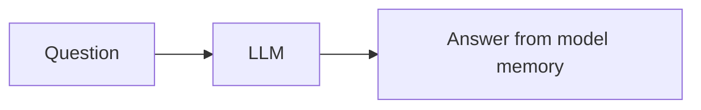
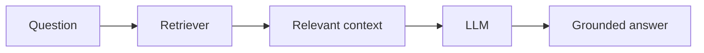
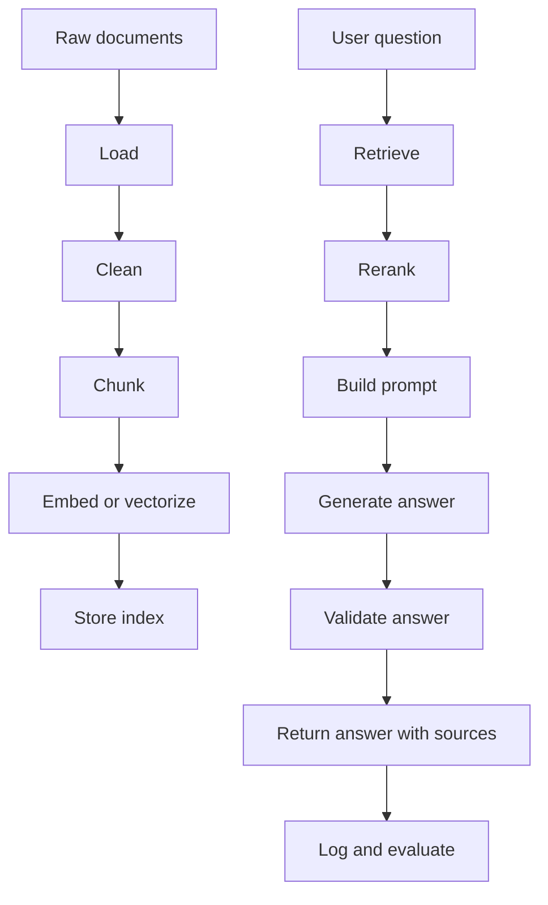

# 02. RAG End-to-End Deep Implementation

## Why RAG Is Needed

LLMs do not automatically know your private data. They also may not know recent changes. RAG solves this by retrieving relevant information at answer time.

Without RAG:



With RAG:



## Full Production RAG Pipeline



## Step 1: Document Loading

The project supports `.txt`, `.md`, `.csv`, and `.json` directly.

The loader creates a `Document` object:

```python
@dataclass
class Document:
    doc_id: str
    text: str
    metadata: Dict[str, str] = field(default_factory=dict)
```

Meaning:

- `doc_id` identifies the document.
- `text` stores the extracted text.
- `metadata` stores source path, file name, type, page number, owner, tenant, etc.

In production, metadata is extremely important. You use it for citations, filtering, permissions, freshness, and debugging.

## Step 2: Cleaning

Cleaning removes noise:

- Extra whitespace.
- Broken newlines.
- Repeated headers.
- Empty pages.
- HTML boilerplate.

Bad cleaning causes bad chunks. Bad chunks cause bad retrieval. Bad retrieval causes bad answers.

## Step 3: Chunking

Chunking splits documents into pieces.

Tradeoff:

- Small chunks are precise but may lose context.
- Large chunks keep context but may retrieve irrelevant text.

In the project:

```python
chunks = chunk_documents(
    documents,
    chunk_size_words=settings.chunk_size_words,
    overlap_words=settings.chunk_overlap_words,
)
```

If chunk size is 120 and overlap is 30:

- Chunk 1 has words 0 to 120.
- Chunk 2 starts at word 90.
- The overlap preserves context between chunks.

## Step 4: Vector Index

A production app usually uses embeddings. This teaching project uses TF-IDF vectors because it is transparent and local.

Embedding intuition:

```text
refund policy -> [0.12, -0.31, 0.77, ...]
return window -> [0.10, -0.29, 0.72, ...]
```

TF-IDF intuition:

- Term frequency: how often a term appears in a chunk.
- Inverse document frequency: how rare the term is across all chunks.
- Rare important words get higher weight.

## Step 5: Keyword Search With BM25

BM25 is strong for exact terms:

- Product IDs.
- Invoice numbers.
- Names.
- Legal clauses.
- Error codes.

The project implements BM25 in `app/rag/bm25.py`.

## Step 6: Hybrid Retrieval

Hybrid retrieval combines semantic-ish vector search and keyword search.

In the project:

1. `LocalTfidfIndex.search()` returns vector-style results.
2. `BM25Retriever.search()` returns keyword-style results.
3. `reciprocal_rank_fusion()` merges both ranked lists.
4. `lexical_rerank_score()` boosts chunks that overlap the question.

This is the same idea used in many production RAG systems, only simplified for learning.

## Step 7: Prompt Construction

The prompt must prevent guessing.

The project prompt says:

```text
Answer only using the context.
If the context does not contain the answer, say:
"I do not know from the provided context."
Mention the source file names used.
```

This is grounding. The model is instructed to answer from retrieved evidence, not from imagination.

## Step 8: Generation

The project has two generator styles:

- `ExtractiveGenerator`: local and free. It selects relevant sentences from retrieved chunks.
- `OpenAIGenerator`: optional API-based generator if you configure a model and API key.

Why include a local generator?

Because learning should not depend on billing, network, or provider access. First understand the system. Then connect a better generator.

## Step 9: Evaluation

Evaluation asks:

- Did the answer contain expected facts?
- Did it cite sources?
- Were retrieved chunks relevant?
- Was latency acceptable?
- Was cost acceptable?

The project has:

```bash
python cli.py eval
```

It runs a small evaluation set in `app/evaluation/evaluate.py`.

## Step 10: API

FastAPI exposes:

- `/health`
- `/admin/reindex`
- `/ask`
- `/agent`

Run:

```bash
uvicorn app.api.main:app --reload --port 8000
```

Open:

```text
http://localhost:8000/docs
```

## Step 11: Deployment

The same project can run:

- Locally with CLI.
- Locally with FastAPI.
- In Docker.
- In ECS/Fargate.
- In EKS.
- In Azure App Service/AKS.
- In GCP Cloud Run/GKE.

That is the purpose of the project structure: learn one app, deploy it multiple ways.

