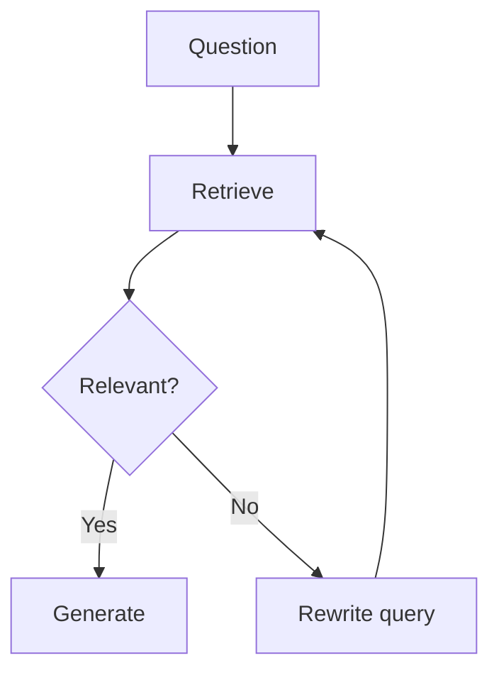

# 04. Advanced RAG Implementation Recipes

## Hybrid Search

Problem:

Vector search understands meaning but can miss exact terms.

BM25 finds exact terms but may miss synonyms.

Solution:

Use both.

Implementation in project:

```python
vector_results = self.index.search(query, top_k=top_k * 3)
keyword_results = self.bm25.search(query, top_k=top_k * 3)
fused_scores = reciprocal_rank_fusion([vector_results, keyword_results])
```

Production upgrade:

- Replace `LocalTfidfIndex` with embeddings plus FAISS/Qdrant/Pinecone.
- Keep BM25 with Elasticsearch/OpenSearch/Weaviate hybrid search.
- Fuse results with RRF.

## Reranking

Retriever gets candidates. Reranker chooses the best final context.

Simple project reranker:

```python
rerank_score = lexical_rerank_score(query, chunk)
final_score = fused_score + rerank_score
```

Production upgrade:

- Cross encoder reranker.
- Cohere-style rerank API.
- Sentence-transformer reranker.
- LLM judge reranking for small candidate sets.

## RAG Fusion

RAG Fusion creates multiple versions of the query.

Example:

```text
Original: How can I reduce hallucination in RAG?
Query 1: RAG grounded answer techniques
Query 2: prevent hallucinations with retrieval augmented generation
Query 3: RAG faithfulness evaluation and citations
```

Then retrieve for all queries and fuse results.

Pseudo-code:

```python
queries = generate_query_variations(question)
all_results = [retriever.search(query) for query in queries]
final_results = reciprocal_rank_fusion(all_results)
```

## HyDE

HyDE means Hypothetical Document Embeddings.

Steps:

1. Ask a model to write a hypothetical answer.
2. Embed the hypothetical answer.
3. Retrieve documents similar to that hypothetical answer.

Why it helps:

Questions are often short. Documents are longer. A hypothetical answer looks more like a document.

## Parent Document Retriever

Problem:

Small chunks retrieve accurately but may lack surrounding context.

Solution:

- Index small child chunks.
- Return larger parent section.

Implementation shape:

```python
child_chunk -> parent_section_id
retrieve child_chunk
load parent_section
send parent_section to generator
```

## Sentence Window Retriever

Problem:

A single sentence matches, but nearby sentences explain it.

Solution:

Return:

- Matching sentence.
- Two sentences before.
- Two sentences after.

Good for:

- Policies.
- Contracts.
- Documentation.
- Medical and legal summaries.

## Contextual Compression

Problem:

Retrieved chunks are long and include irrelevant text.

Solution:

Compress each chunk against the query.

Methods:

- Extract matching sentences.
- Use an LLM to summarize only relevant parts.
- Drop chunks below relevance score.

## Lost in the Middle

LLMs often pay more attention to the beginning and end of long context.

Fix:

- Keep context shorter.
- Put most relevant chunk first.
- Put final summary near the end.
- Rerank strongly.
- Avoid dumping 50 chunks into prompt.

## Self-Query Retriever

Problem:

Some queries contain filters.

Example:

```text
Show refund policies for enterprise customers after 2025.
```

Need:

```json
{
  "customer_type": "enterprise",
  "year_gte": 2025
}
```

Implementation:

1. Extract filters.
2. Apply metadata filtering.
3. Run semantic search inside filtered documents.

## Corrective RAG

Corrective RAG checks whether retrieval is good enough.

Flow:



## Self-RAG

Self-RAG makes the model evaluate:

- Do I need retrieval?
- Are retrieved docs relevant?
- Is my answer supported?

This is powerful but slower and more expensive.

## Agentic RAG

Agentic RAG gives the system tools:

- Vector search.
- Keyword search.
- SQL.
- Web search.
- Calculator.
- Human clarification.

The agent decides which tool to use.

## Graph RAG

Use graph RAG when relationships matter.

Example:

```text
Which suppliers are connected to delayed orders for Product X?
```

This needs:

```text
Product -> Order -> Shipment -> Supplier
```

Vector search alone may not follow the relationship correctly.

## Advanced RAG Production Checklist

- Evaluate retrieval separately from generation.
- Store source metadata.
- Use access filters before retrieval.
- Use hybrid search for exact terms.
- Rerank before generation.
- Keep context short.
- Cite sources.
- Log chunk IDs.
- Add failure mode: "I do not know."
- Add feedback capture.

