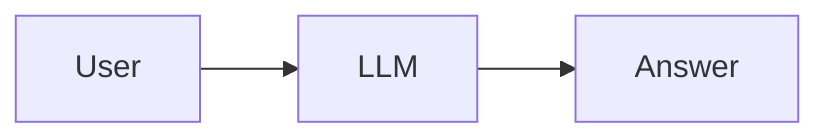
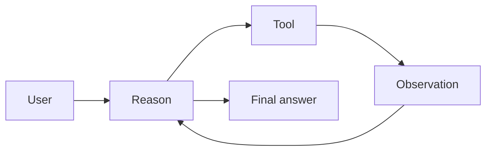
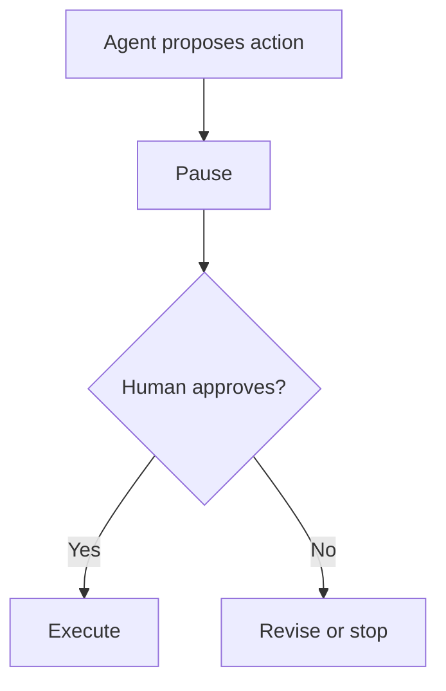
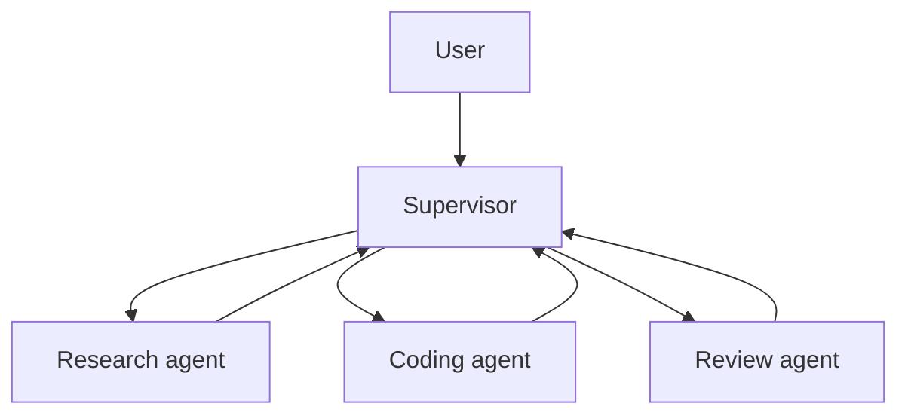

# 05. Agents, LangGraph, Memory, and Multi-Agent Implementation

## What Is an Agent?

An agent is a system that can decide steps, call tools, observe results, and continue toward a goal.

Basic chatbot:



Agent:



## Tool Calling

A tool is a function the agent can use.

Examples:

- Search knowledge base.
- Calculate.
- Query database.
- Send email.
- Book appointment.
- Check calendar.

The project has:

```python
safe_calculate(expression)
search_knowledge_base(pipeline, question)
```

## ReAct

ReAct means reasoning plus acting.

Loop:

1. Think what is needed.
2. Pick tool.
3. Use tool.
4. Observe result.
5. Decide next step.

## LangGraph Intuition

LangGraph is a graph of nodes and edges.

Node:

- A function that reads and updates state.

Edge:

- A connection to the next node.

State:

- Shared memory for the workflow.

Project equivalent:

```python
state = route(state)
state = act(state, pipeline)
state = respond(state)
```

This is a tiny LangGraph-style workflow from scratch.

## Memory

Memory types:

- Buffer memory: all messages.
- Window memory: last few messages.
- Summary memory: compressed history.
- Entity memory: important facts.
- Vector memory: searchable memory.

In production:

- Do not store everything forever.
- Avoid storing secrets.
- Separate user memory by tenant/user.
- Let users delete memory if required.

## Human-in-the-Loop

Use human approval for:

- Sending email.
- Booking appointment.
- Payment.
- Refund.
- Deleting data.
- Production deployment.

Graph shape:



## Multi-Agent Patterns

### Network Pattern

Agents talk to each other freely.

Good for research and brainstorming.

Risk:

- Hard to control.
- Can loop.

### Supervisor Pattern

One supervisor routes work.



Good for production because control is clearer.

### Pipeline Pattern

Each agent has a fixed stage.

Example:

1. Extract facts.
2. Retrieve context.
3. Draft answer.
4. Verify answer.
5. Format output.

## Doctor Appointment Agent

Nodes:

- Extract patient request.
- Identify specialty.
- Search doctors.
- Check slots.
- Ask human confirmation.
- Book appointment.
- Send confirmation.

State:

```json
{
  "symptoms": "...",
  "specialty": "dermatology",
  "doctor_id": "D123",
  "slot": "2026-07-10 10:30",
  "confirmed": false
}
```

## Finance Bot

Tools:

- Market price tool.
- Company filings retriever.
- News retriever.
- Calculator.

Safety:

- Add financial disclaimer.
- Do not guarantee returns.
- Cite sources.

## SQL Agent

Important rule:

Never let the model execute arbitrary SQL directly.

Safe flow:

1. Model proposes query.
2. Validate query.
3. Allow only read-only statements.
4. Limit rows.
5. Log query.
6. Return result.

## Agent Evaluation

Test:

- Did the agent choose the right tool?
- Did it call tools with valid arguments?
- Did it stop?
- Did it avoid unsafe tools?
- Was final answer correct?
- Was latency acceptable?

