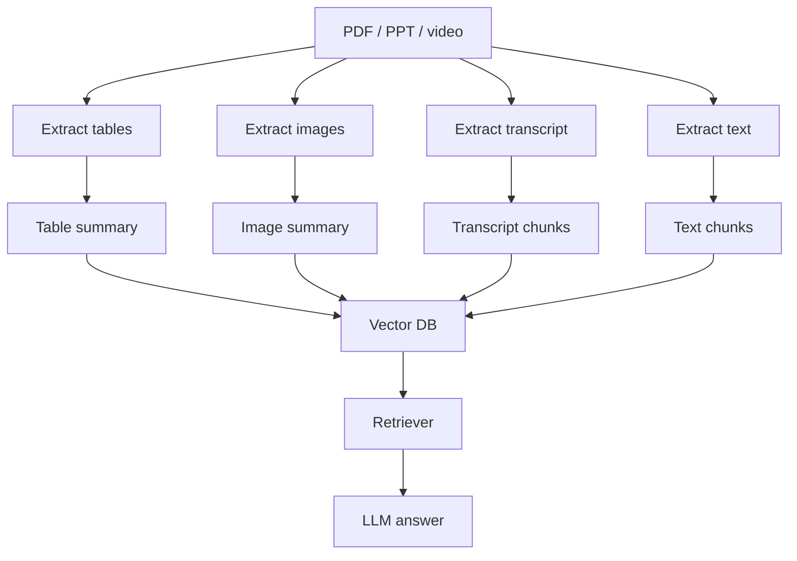
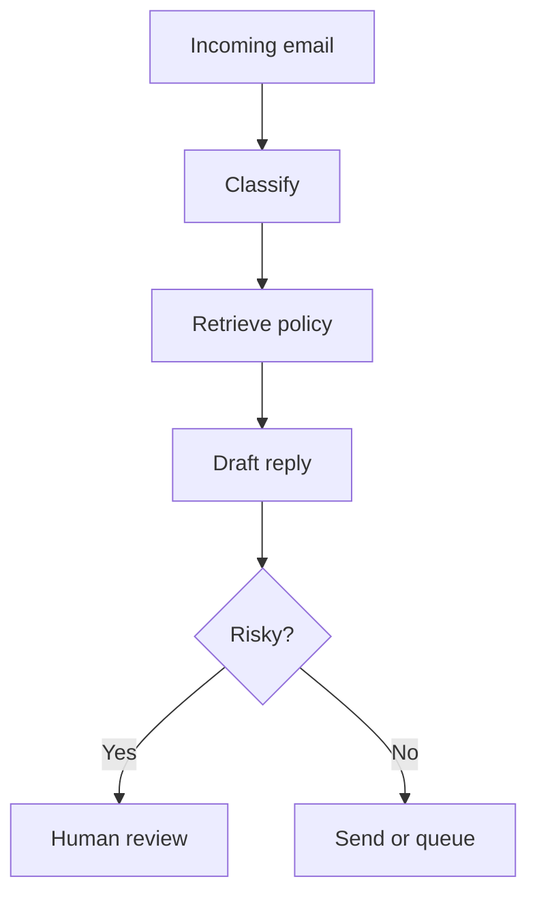

# 08. Multimodal, Voice, Video, Dialogflow, and Coding-Agent Projects

## Multimodal RAG

Multimodal RAG handles text, tables, images, audio, or video.

Pipeline:



## Image and Table Extraction

For PDFs:

- Extract normal text.
- Extract tables with a table parser.
- Extract images.
- Use OCR for scanned pages.
- Summarize images and tables.

Store metadata:

- Page number.
- Image ID.
- Table ID.
- Source file.

## Video RAG

Steps:

1. Extract audio.
2. Transcribe audio.
3. Split transcript by timestamp.
4. Extract key frames.
5. Summarize frames.
6. Index transcript chunks and frame summaries.
7. Answer with timestamps.

## Multilingual Voice Assistant

Pipeline:


Implementation plan:

1. Capture audio.
2. Convert speech to text.
3. Send text to RAG/agent backend.
4. Generate answer.
5. Convert answer to speech.
6. Play audio.

## Dialogflow-Style Weather Bot

Dialogflow-style systems use intents and entities.

Intent:

```text
get_weather
```

Entities:

```json
{
  "location": "Bengaluru",
  "date": "tomorrow"
}
```

Fulfillment:

1. Receive intent.
2. Validate entities.
3. Call weather API.
4. Format answer.
5. Return response.

LLM agent version:

1. User asks weather question.
2. Model extracts location and date.
3. Tool calls weather API.
4. Model explains result.

## Text-to-Video

Text-to-video prompt:

```text
A 10 second educational animation showing documents being split into chunks,
converted into vectors, stored in a vector database, and retrieved for a user question.
Clean technical style, readable labels, smooth camera movement.
```

Production concerns:

- Copyright.
- Likeness and consent.
- Brand safety.
- Inaccurate visuals.
- Flicker.
- Text artifacts.

## Customer Support Email Agent

Workflow:



Categories:

- Refund.
- Shipping.
- Account access.
- Billing.
- Technical issue.
- Escalation.

Guardrails:

- Never promise policy exceptions automatically.
- Never expose internal notes.
- Human review for angry, legal, financial, or safety-sensitive messages.

## AI Coding-Agent Workflow

Good coding-agent use:

1. Give goal.
2. Let agent inspect files.
3. Ask for implementation.
4. Run tests.
5. Review diff.
6. Deploy only after verification.

Bad coding-agent use:

- Giving vague tasks.
- Skipping tests.
- Pasting secrets.
- Deploying unreviewed code.

