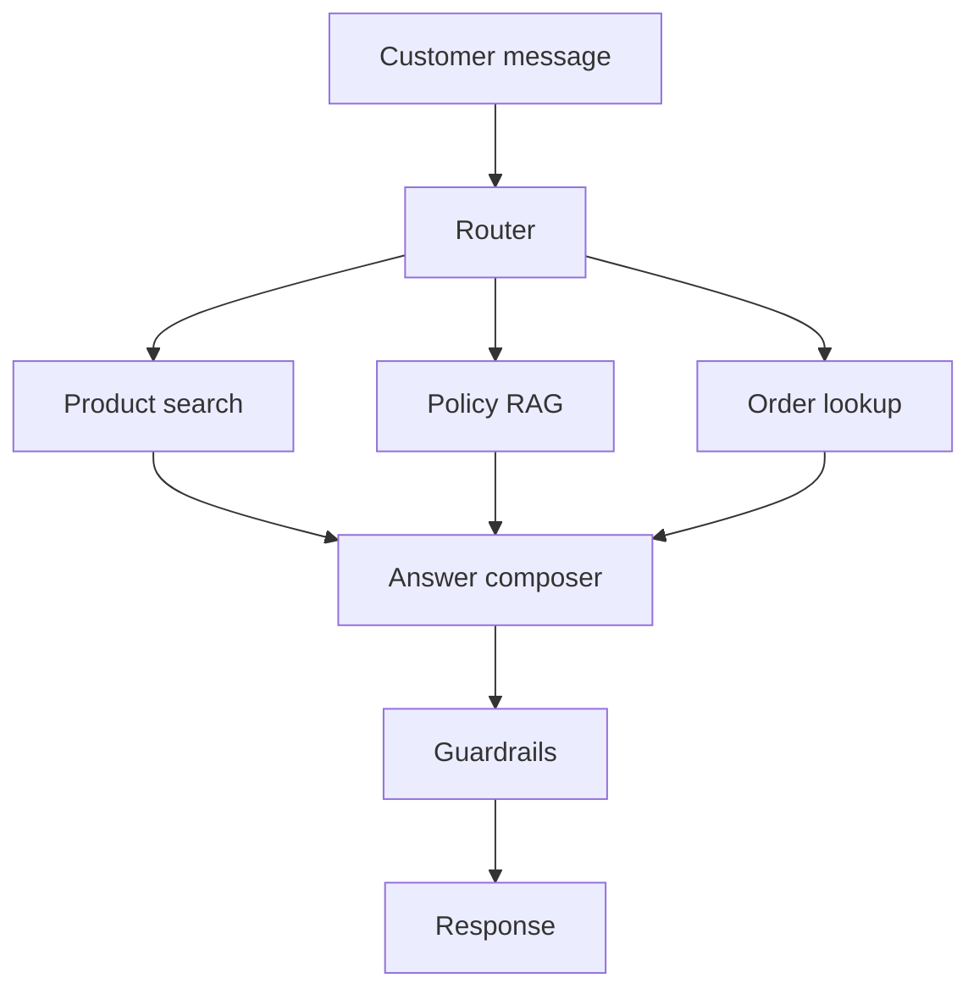
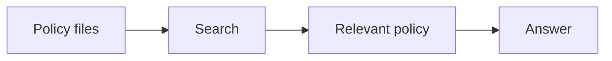

# 10. Project: End-to-End E-Commerce Chatbot

Project folder:

```text
projects/ecommerce_chatbot_fastapi
```

## Aim

Build a chatbot for an online store that can:

- Recommend products.
- Answer policy questions.
- Track orders.
- Enforce user authorization.
- Flag risky actions for human review.
- Run as a FastAPI backend.
- Run in Docker.

## Architecture



## Why This Project Matters

This is close to a real business GenAI use case. It combines public information and private user-specific data.

Public data:

- Product catalog.
- Shipping policy.
- Refund policy.
- Warranty policy.

Private data:

- Order status.
- Tracking number.
- User ID.

The chatbot must never expose one user's order to another user.

## Step 1: Product Search

File:

```text
app/services/catalog.py
```

Purpose:

- Load product data from `products.json`.
- Match user query against product name, category, description, and tags.
- Return top matching products.

Core method:

```python
def search(self, query: str, limit: int = 3) -> List[Dict]:
```

Step-by-step:

1. Convert query into lowercase terms.
2. Build searchable text for every product.
3. Count how many query terms appear.
4. Sort products by score.
5. Return top results.

Production upgrade:

- Use embeddings for semantic product search.
- Add filters for price, color, size, stock.
- Use database search instead of JSON.

## Step 2: Policy RAG

File:

```text
app/services/policies.py
```

Purpose:

- Load policy text files.
- Search policy documents.
- Return grounded answer with source files.

This is a small RAG system:



Production upgrade:

- Chunk policy documents.
- Embed chunks.
- Store in vector DB.
- Add source citations.
- Add versioning for policies.

## Step 3: Order Lookup

File:

```text
app/services/orders.py
```

Purpose:

- Find order ID in user message.
- Load order data.
- Check whether order belongs to the requesting user.
- Return status only if authorized.

Important method:

```python
def get_order_for_user(self, order_id: str, user_id: str) -> Optional[Dict]:
```

This is the security step. If `order["user_id"] != user_id`, the chatbot refuses.

## Step 4: Guardrails

File:

```text
app/services/guardrails.py
```

Risky messages include:

- Refund now.
- Cancel order.
- Change address.
- Legal.
- Chargeback.

When risky text appears, the response sets:

```python
needs_human_review=True
```

Production upgrade:

- Add moderation model.
- Add policy engine.
- Add approval queue.
- Add audit logs.

## Step 5: Router

File:

```text
app/services/router.py
```

The router decides:

- `order_lookup`
- `policy_rag`
- `product_search`
- `fallback`

This is a simple version of an agent router. In production, you can replace it with:

- LLM classifier.
- Fine-tuned intent classifier.
- LangGraph router node.

## Step 6: API

File:

```text
app/main.py
```

Endpoint:

```text
POST /chat
```

Payload:

```json
{
  "user_id": "user_1",
  "message": "track order ORD1001"
}
```

Response:

```json
{
  "answer": "...",
  "route": "order_lookup",
  "sources": ["orders.json"],
  "needs_human_review": false
}
```

## Run Commands

```bash
python cli.py "recommend running shoe"
python cli.py "what is the refund policy"
python cli.py "track order ORD1001" --user-id user_1
pytest
uvicorn app.main:app --reload --port 8001
```

## Deployment Steps

Local Docker:

```bash
docker build -t ecommerce-chatbot .
docker run -p 8001:8000 ecommerce-chatbot
```

AWS ECS:

1. Build Docker image.
2. Push to ECR.
3. Create ECS task definition.
4. Add environment variables.
5. Deploy Fargate service.
6. Add load balancer.
7. Configure health check.

Production database upgrade:

- Products: Postgres or MongoDB.
- Orders: internal order API.
- Policies: vector database.
- Logs: CloudWatch/OpenTelemetry.

