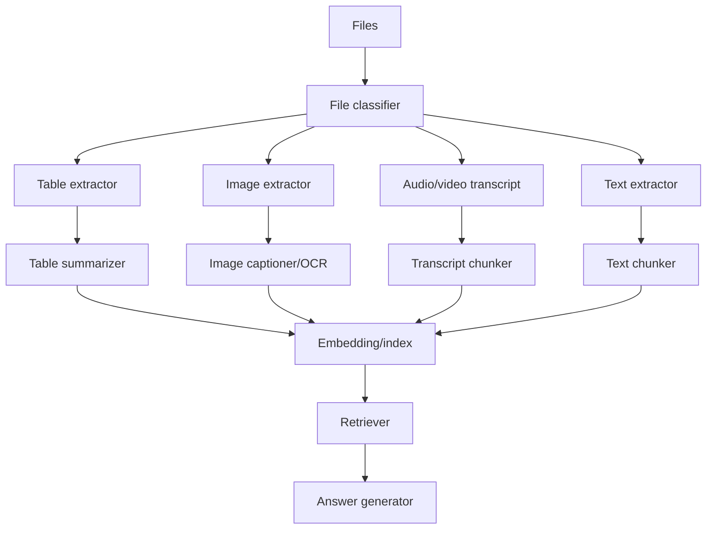
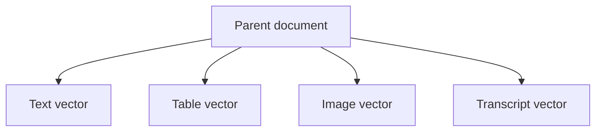

# 11. Project: Multimodal RAG End to End

This is a full implementation plan for the multimodal RAG topics in the roadmap.

## Aim

Build a system that answers questions from:

- PDFs.
- Images.
- Tables.
- Slide decks.
- Video transcripts.

## Architecture



## Step 1: File Classification

Decide file type:

- `.pdf`
- `.docx`
- `.pptx`
- `.png`
- `.jpg`
- `.mp4`
- `.csv`

Routing matters because every file type needs a different parser.

## Step 2: Text Extraction

For digital PDFs:

- Extract embedded text.
- Preserve page number.
- Preserve section headings.

For scanned PDFs:

- Convert page to image.
- Run OCR.
- Store OCR confidence.

## Step 3: Table Extraction

Tables need structure.

Bad extraction:

```text
Product Price Stock A 100 5 B 200 3
```

Better extraction:

```json
[
  {"product": "A", "price": 100, "stock": 5},
  {"product": "B", "price": 200, "stock": 3}
]
```

Index both:

- Raw table.
- Natural language summary.

## Step 4: Image Extraction

For each image:

- Store file/page location.
- Generate caption.
- Run OCR if image contains text.
- Store visual summary.

Example image summary:

```text
Bar chart showing Q1 revenue at $2M, Q2 at $2.4M, and Q3 at $3.1M.
```

## Step 5: Video RAG

Video processing:

1. Extract audio.
2. Transcribe audio.
3. Split transcript by timestamp.
4. Extract keyframes every N seconds.
5. Caption keyframes.
6. Index transcript chunks and keyframe captions.

Answer should cite timestamps:

```text
The speaker explains hybrid search at 00:12:31.
```

## Step 6: Multi-Vector Retrieval

A single document can have multiple vectors:

- Text vector.
- Table summary vector.
- Image caption vector.
- Transcript vector.

All point back to the same parent document.



## Step 7: Answer Generation

Prompt should include modality:

```text
Source: annual_report.pdf page 9 table 2
Type: table summary
Content: Revenue increased from $2M to $3.1M.
```

This helps the model explain whether evidence came from text, image, table, or video.

## Production Checklist

- OCR confidence stored.
- Page numbers preserved.
- Table structure preserved.
- Image captions reviewed for accuracy.
- Timestamps preserved for video.
- Source citations visible.
- Access control before retrieval.
- Large files processed asynchronously.

